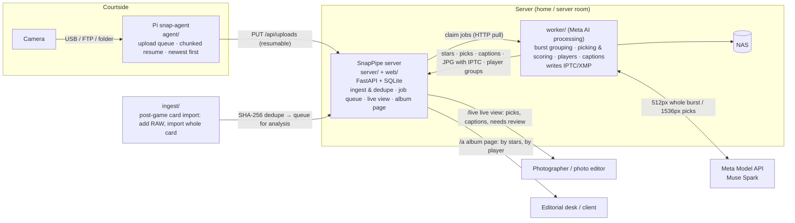

[繁體中文](README.md) | **English**

# SnapPipe

**A real-time photo delivery system for sports photojournalism.** Seconds after the shutter fires, the photo is already backed up on the server. Meta AI compares every frame of a burst against the others to pick the decisive moment, reads jersey numbers, matches them against the roster, drafts a wire-service-style caption and writes it into IPTC. An editor confirms it on a web page, copies the caption, and files the photo.

**One server (one LXC) = one shoot plan = one album.** Photos sent live from the Pi, photos imported from the card after the game, and photos shot across midnight all go into the same album; nothing is split by date. To shoot another plan, create another LXC.

A project for the Meta Global AI Developer Hackathon 2026. Design and application documents:

- [Design Document (Chinese)](docs/DESIGN.md)
- [Application Draft (English)](docs/APPLICATION.md)
- [Architecture and protocols (implementation)](docs/ARCHITECTURE.md)



| Where | Component | What it does |
|---|---|---|
| Next to the camera | `agent/` snap-agent (Raspberry Pi) | Detects new photos → upload queue (SQLite) → 1MB chunked PUT, resumable, newest first; sends heartbeats with its status and receives "which album to upload into". Only relays, does no computation |
| Server | `server/` (FastAPI + SQLite), `web/` (Vue 3) | Receives files, SHA-256 dedupe, thumbnails, job queue, live view, album page, share links |
| Any machine | `worker/` | Claims jobs from the server → assembles bursts → two-stage Meta Model API analysis → writes IPTC/XMP → swaps in the JPG with metadata → groups by player → NAS. Can run on the same machine as the server |
| Any machine | `ingest/` | Post-game card import: copies the whole card, adds RAW files, uploads photos that didn't make it live and queues them for Meta AI analysis (Mac and Linux) |

**Goal: under 60 seconds from shutter to "a fileable photo with a draft caption."** The hot path (camera → Pi → server → live view) never waits on AI; AI is an asynchronous enhancement, and picks, stars and captions are filled in when the results come back. If the Meta API is slow or down, photos still show up in the live view as usual.

## How Meta AI is used

The worker's `meta_ai` analyzer (`worker/analyzers/meta_ai.py`) calls the [Meta Model API](https://dev.meta.ai/docs/quickstart) (`muse-spark-1.3`, Chat Completions + images + JSON Schema structured output) in two stages:

| | Stage 1: compare the burst and pick | Stage 2: player identification and caption |
|---|---|---|
| When | Photos from the same camera taken ≤ 0.5 s apart form a group; it is sent once no new photo arrives for 1.5 s | Only for the 1–3 frames picked in stage 1 |
| Sends | The whole group (up to 40 frames) as 512px thumbnails, plus each frame's time offset and locally computed sharpness | One 1536px image + game data (event, venue, home/away jersey colors) + roster |
| Gets back | Best frame; overall / peak / focus / composition scores for every frame; problems (out of focus, blocked face…); action type | For each player: team, number, confidence, bounding box; a one-sentence action description, headline, keywords |
| Used for | Stars, AI pick (◆), IPTC Urgency, `xmp:Label=Select` | Caption, headline, `PersonInImage`, "by player" grouping |

**Keeping AI from making up facts (news ethics)**

- **The model never writes names.** In its description it may only refer to people in the players array as `{P0}`, `{P1}`; the worker looks up the number in the roster and substitutes something like "Taipei Hawks Wang Hsiao-ming (#23)" (example; Chinese output: 台北雄鷹隊王小明（#23）). If the number isn't on the roster it writes "No. 23" instead. If the model breaks the rule and writes a name directly, the photo is flagged for human review.
- **Only the "who is doing what" sentence is written by AI.** Date, city, venue, event and photographer byline are filled in from the template and the game data (`worker/games/`).
- **Needs human review**: when a player's confidence is < 0.8, the main subject's number isn't on the roster, or the model itself is unsure, the live view marks the photo ⚠ and lists the reasons.
- **No face recognition.** Identity comes only from jersey number + roster.
- **Human in the loop.** AI only produces drafts; a photo is filed only after an editor reviews it and copies the caption.
- **Degradation**: if the model's output is malformed, the worker falls back to ranking by local sharpness and the photo still completes; on network errors, 429 or 5xx, the whole group backs off and retries.

**Privacy**: the default is the standard plan, `muse-spark-1.3`. **Do not use a `-contributor` plan**: under that plan Meta may train its models on the photos and captions you send (the worker warns about this at startup). What gets sent are downscaled images (512px / 1536px), not the originals.

**Cost** (measured in 2026-10 with `muse-spark-1.3`; Meta's public list price is $1.25 input / $4.25 output per million tokens): picking with tags costs about US$0.0014 per photo, and captioning about US$0.0071 per photo. Captions are written only when there is a shoot plan (or sports game data), and only for 5-star picks. For a 3,000-photo event: without a shoot plan (stars and tags only), about US$4.1; with a shoot plan and about 100 five-star picks captioned, about US$4.8. The worker records each group's token usage on the job result on the server; experiment logs are in `tests/meta_api/sets/saki/results/`.

## Requirements

| Where | Requirements |
|---|---|
| Server | A Debian 12 / Ubuntu 22.04+ LXC, VM or bare-metal machine (Python 3.10+), root |
| worker | Python 3.10+, [exiftool](https://exiftool.org); Mac (Homebrew) or Linux, or on the same machine as the server. Requires a Meta Model API key |
| Raspberry Pi | Raspberry Pi OS Bookworm. A **Pi Zero 2 W** is enough (it only relays and does no computation; the bottleneck is 2.4GHz Wi-Fi). Camera USB tethering mode requires libgphoto2 |
| Card-import computer | Mac or Linux, Python 3.10+, exiftool |
| Network | The Pi and the worker must be able to reach the server: LAN, WireGuard / Tailscale, or an HTTPS URL behind a reverse proxy; the worker must be able to reach `api.meta.ai` |
| NAS (optional) | An SMB shared folder |

```bash
git clone https://github.com/normantaipei/SnapPipe.git
cd SnapPipe
```

## Recommended install order

**Language:** every installer takes `--lang en` (or the environment variable `SNAPPIPE_LANG=en`). With it, the installers' prompts, the "next steps" summary printed at the end, and the default tags and captions are in English. Leave it off and you get Traditional Chinese. All install commands in this README already include `--lang en`.

Dependencies: **server → worker → Raspberry Pi**. Install the server first, because it generates the tokens the other two need; install the Pi last, because it starts uploading to the server as soon as it boots.

| Step | Device | What to do | How to verify |
|---|---|---|---|
| 1 | Server | Install (§1); note the upload token and device token it prints | Open `http://<server-IP>:8080` in a browser and see the home page; `snappipe-live status` reports live upload as on |
| 2 | worker | With §1 install method A it is already installed in the same LXC (the installer asked for the Meta API key); to put it on a Mac or another machine, run `worker/setup.sh` (§3). Write the game data (§3) | `worker/worker.sh --status` prints the queue; `tests/e2e/run.sh` passes |
| 3 | Card-import computer (optional) | Paste the `ingest.sh … --save` command printed by the server (§4) | `ingest/ingest.sh --servers` shows the connection is OK |
| 4 | Raspberry Pi | One-line install (§2) with the server URL and device token | `snap_agent.py test` returns OK; `worker.sh --status` shows this device's heartbeat |
| 5 | End to end | Shoot a burst | Photos appear in `/live/<live-key>` within seconds, and a few seconds later the ◆ pick and caption are filled in |

**On game day:**

1. **Before the game**: one LXC per game (the shoot plan name you enter during installation is the album name; you can change it later with `snappipe-live album <new name>`). This game's data and roster are the shoot plan, written in `worker/games/default.toml / default.csv`. Under `[cameras]`, list who shoots with each body, and the caption byline is filled in automatically.
2. **Tip-off**: the worker runs as a service (systemd / launchd); the Pi connects and uploads on its own after boot; the photo editor opens `/live/<live-key>` and clicks "◆ Picks only".
3. **During the game**: open a pick to see the draft caption; check names on ⚠ photos first; click "Copy caption" and paste into the publishing system. Downloaded JPGs already carry the IPTC caption, headline, names and stars.
4. **After the game**: insert the card and run `ingest/ingest.sh` to add RAW files and photos that didn't make it live (photos already sent live are skipped automatically and not re-analyzed); turn off live upload with `snappipe-live off`.

## 1. Server

When installation finishes it prints the tokens and the settings the worker, Pi and card-import computer need. Re-running updates in place; photos, the database and tokens are kept. Settings live in `/etc/snappipe.env`; if you forget them, run `snappipe-cmd` on the server.

**Install method A (one line in the Proxmox shell: creates an LXC and installs the album site and the worker)**

```bash
curl -fsSL https://raw.githubusercontent.com/normantaipei/SnapPipe/main/deploy/create-lxc.sh | bash -s -- --install --lang en
```

It starts by asking for the **shoot plan name** (one LXC holds only this shoot plan; it is also the name of its one and only album), disk size, **public URL** (the HTTPS domain of your reverse proxy, used for Pi uploads from outside and for share links; leave blank if you don't have one) and the **Meta API key** (input is hidden; it is validated against Meta on the spot at no charge; if validation fails it tells you why and asks again; **press Enter to leave it blank = no AI, just a plain album site**). After that you don't need to stay at the keyboard: it creates the container, installs the album site, installs the worker in the same container and sets it to start on boot, all without you entering the container.

If you don't want the worker installed (because it will run on a Mac or another machine), add `--no-worker`; for automation, use `--meta-key <key>` or `--no-ai` to skip the prompt. To change the key later, or to turn AI on if you left it blank, it is again one line in the Proxmox shell:

```bash
curl -fsSL https://raw.githubusercontent.com/normantaipei/SnapPipe/main/deploy/create-lxc.sh | bash -s -- --set-key --id <CTID> --lang en
```

Update (album site and worker together; the key and photos are kept):

```bash
pct exec <CTID> -- bash -c 'curl -fsSL https://raw.githubusercontent.com/normantaipei/SnapPipe/main/bootstrap.sh | bash -s -- --no-prompt --lang en'
```

At the end the installer prints the "next steps": a one-line install command for each Pi (URL and token already filled in), **this album's links, ready to use now** (the album page for clients and the live view for photographers; the album is created at install time, so you can hand out the links before there are any photos), the post-game card-import command, and common commands. If you forget, run `pct exec <CTID> -- /usr/local/bin/snappipe-cmd` on Proxmox; for just the links, use `pct exec <CTID> -- /usr/local/bin/snappipe-live links`.

**Another shoot plan**: run the one-liner above again to create a new LXC (it automatically uses the next container ID). Each LXC has its own album, its own links and its own shoot plan.

worker logs: `pct exec <CTID> -- journalctl -u snappipe-worker -f`. Game data lives in `/opt/snappipe/src/worker/games/` inside the container.

**Install method B (an existing Debian / Ubuntu machine, run as root)**

```bash
curl -fsSL https://raw.githubusercontent.com/normantaipei/SnapPipe/main/bootstrap.sh | bash -s -- --lang en
```

**Install method C (package on your own computer and install over SSH; use this if you fork into a private repo)**

```bash
ssh root@<PVE_IP> "bash -s -- --ssh-key '$(cat ~/.ssh/id_ed25519.pub)' --lang en" < deploy/create-lxc.sh   # create the LXC (skip if you already have one)
./deploy/build-installer.sh && scp dist/snappipe-install.sh root@<server-IP>:/tmp/ && ssh -t root@<server-IP> bash /tmp/snappipe-install.sh --lang en
```

If you fork, point the environment variables `SNAPPIPE_GIT` and `SNAPPIPE_REPO` at your own repo.

**Live upload master switch** (run on the server; takes effect immediately):

```bash
snappipe-live off      # Pis pause uploading (photos stay on the card) and /live is closed; the album page and card-import uploads keep working
snappipe-live on
snappipe-live status   # switch state, devices, queue, and the album's album page / live view URLs
snappipe-live links    # the album's album page / live view URLs
snappipe-live album                    # show the album name
snappipe-live album Saki shoot Oct 30  # rename the album (spaces are OK; links don't change)
```

Album: each server has exactly one, named after the shoot plan name entered at install time. Album names sent by a Pi, the card-import `--album` option and photo capture dates never split off a separate album. When updating from an older version (which split albums by date), all albums are merged into one automatically (the album with the most photos is kept as the base), and the old album page and live view links redirect to the merged album. If you really need the old behavior, add `SNAPPIPE_SINGLE_ALBUM=0` to `/etc/snappipe.env`.

For a container on Proxmox you can run `pct exec <CTID> -- /usr/local/bin/snappipe-live off`; you can also run `worker/worker.sh --live off|on` on the worker machine.

Live-path settings in `/etc/snappipe.env`:

| Variable | Description |
|---|---|
| `SNAPPIPE_DEVICE_TOKENS` | `name:token`, comma-separated for multiple Pis. To add a Pi, add another pair and `systemctl restart snappipe` |
| `SNAPPIPE_WORKER_TOKEN` | Empty by default = LAN trust mode: the worker and admin APIs are open to direct LAN connections without a token. Set it only if the worker connects from outside via VPN / reverse proxy |
| `SNAPPIPE_UPLOAD_TOKEN` | For card-import ingest and admin commands (direct LAN connections only) |
| `SNAPPIPE_DEVICE_NETS` / `SNAPPIPE_WORKER_NETS` | Optional; restrict source networks (CIDR) |
| `SNAPPIPE_JOB_LEASE`, `SNAPPIPE_JOB_MAX_ATTEMPTS` | Job lease in seconds (600); how many failures before a job is marked dead (5) |
| `SNAPPIPE_LIVE_WINDOW` | How long after an album's last update the album page keeps auto-polling (900 seconds) |

## 2. Raspberry Pi snap-agent

At the end of the server install, a one-line install command is printed for each Pi (URL and device token already filled in); paste it into the Pi and run it. If you forget, run `snappipe-cmd` on the server (Proxmox: `pct exec <CTID> -- /usr/local/bin/snappipe-cmd`). The command looks like this:

```bash
curl -fsSL https://raw.githubusercontent.com/normantaipei/SnapPipe/main/agent/bootstrap.sh | sudo bash -s -- \
  --url http://<server-IP>:8080 --token <device-token> --name pi-1 --mode gphoto2 --lang en
```

Set `--mode` to `gphoto2` (camera connected to the Pi over USB), `ftp` (the Pi runs an FTP server for the camera and prints the credentials to enter on the camera) or `watch`; `--send-raw` uploads RAW files too. `--battery ups-c` (Waveshare UPS HAT (C)) / `pisugar` makes the Pi report its battery level, shown with charging state on the device cards of the live page; `--display lcd144` uses the 1.44-inch LCD HAT. Re-running the same line updates the agent. The config file is `/etc/snap-agent.toml` (template: `agent/config.example.toml`).

| mode | Best for | Description |
|---|---|---|
| `gphoto2` | Cameras without FTP | Camera connected to the Pi over USB, set to PC remote / PTP, saving photos to the memory card (Sony: save destination "PC+Camera"). Listens for `FILE_ADDED` and immediately reads the file into the Pi's staging area before uploading; camera power-off, a pulled cable or a Pi reboot won't lose photos already received |
| `ftp` | Cameras with built-in FTP (most Sony, Canon, Nikon bodies) | The Pi runs FTP (default port 2121) for the camera to connect to and relays whatever it receives. Camera ↔ Pi is plain FTP, only between the camera and the Pi |
| `watch` | Anything else | Watches a folder and uploads any new JPG |

**The memory card is the ultimate safety net**: the Pi only tracks "what hasn't been sent yet," resumes after disconnects and reboots, and sends the newest first. We recommend setting the camera to JPG M / S (about 2–5MB) for live transfer and leaving RAW on the card to add after the game; with `send_raw = true`, RAW files are queued after all JPGs and only sent during quiet periods, and they yield immediately when a new JPG arrives.

Burst grouping relies on the EXIF capture time (with milliseconds) and the camera body serial number. Sony JPGs don't always include the serial number; in gphoto2 mode the Pi reads it over PTP and fills it in. Without a serial number, grouping is done per Pi.

Common commands (`sudo -u snap /opt/snap-agent/.venv/bin/python /opt/snap-agent/snap_agent.py …`): `status`, `album <album>` / `album --clear`, `retry`, `send a.jpg`, `test`. Optional status screen: a 0.96-inch SSD1306 OLED (`type = "oled"`, wiring at the top of `agent/display.py`) or the Waveshare 1.44-inch LCD HAT (`type = "lcd144"`, plugs straight onto the 40-pin header; the backlight dims and turns off on its own and only lights up for problems or a key press — see the top of `agent/display_lcd.py`). For the Waveshare UPS HAT (C) battery level, set `battery_cmd = "ina219:1:0x43"`.

## 3. worker (Meta AI processing)

With §1 install method A, the worker is already installed in the same LXC and set to start on boot, so you can skip the install steps in this section (its config file is `/opt/snappipe/src/worker/.env` inside the container). To install the worker on a Mac or another machine:

```bash
cd worker && ./setup.sh --lang en      # create venv, install exiftool; create .env and games/default.toml; ask for the Meta API key
nano .env                              # SERVER_URL
./worker.sh                            # run continuously; Ctrl-C to stop
./worker.sh --once                     # process the current queue and exit
./worker.sh --status                   # the server's queue, devices, albums and live view URLs
```

**Meta API key**: `setup.sh` asks for it (input is hidden) and first validates it against Meta (using the list-models endpoint, at no charge), saving it to `.env` only after confirming the key is valid and the model is available. If validation fails it tells you why (wrong key, model not found…) and asks you to enter it again. Meta has no API for checking billing status, so **if you haven't added a credit card yet, you won't find out until the first analysis**: the worker log says "the account has no payment method set up or has run out of credit," photos still go into the album as usual (stars and picks fall back to local sharpness estimates, and no captions are written), and once you fix it on the Billing page at dev.meta.ai, the next group works again. **Press Enter to leave it blank and run without AI**: `ANALYZER=none`; photos still go into the album live and can be browsed and downloaded, they just aren't scored, picked or captioned, so it works as a plain album.

```bash
./setup.sh --ask-key --lang en          # change the key / turn on AI later
./setup.sh --api-key <key> --lang en    # automated install: pass the key directly (or set the META_API_KEY env var); stops if validation fails
./setup.sh --no-ai --lang en            # no AI
```

If it isn't run from a terminal (systemd, automation scripts) and no key is passed, it likewise sets up without AI; run `./setup.sh --ask-key` in a terminal later to turn it on. The worker also reads the `META_API_KEY` environment variable (which takes precedence over `.env`).

Starting on boot: on Linux use `worker/snappipe-worker.service` (systemd; instructions at the top of the file); on Mac use `worker/launchd/com.snappipe.worker.plist`. When it runs on the same machine as the server, use `SERVER_URL=http://127.0.0.1:8080`.

Key `.env` settings (full documentation in `worker/.env.example`):

| Variable | Default | Description |
|---|---|---|
| `SERVER_URL` | | One or more servers (comma-separated) |
| `META_API_KEY` | | [dev.meta.ai](https://dev.meta.ai) dashboard → API keys; `setup.sh` asks for it and validates it. Keep it only in `.env` (permissions 600, already in `.gitignore`) |
| `META_MODEL` | `muse-spark-1.3` | Don't use `-contributor` (your data would be used for training) |
| `META_REASONING` | `low` | `minimal` / `low` / `medium` / `high`; higher is slower and more expensive |
| `META_CONCURRENCY` | 4 | How many bursts to send at once |
| `BURST_GAP_SEC` / `BURST_IDLE_SEC` / `BURST_MAX` | 0.5 / 1.5 / 40 | Burst grouping: frame gap, seconds without a new photo before sending, max frames per group |
| `CAPTION` / `MAX_PICKS` | 1 / 3 | Whether to run stage 2; max picks per group |
| `PICK_MIN_SCORE` | 4 | Minimum score for the second and third picks; if the whole group is weak, only the top pick is kept |
| `CAPTION_MIN_STARS` | 5 | With a shoot plan, only write captions for picks at or above this star rating (0 = caption every pick) |
| `REVIEW_CONF` / `PLAYER_MIN_CONF` | 0.8 / 0.7 | Below the first, human review is required; at or above the second, the player goes into "by player" grouping |
| `SCORE_WEIGHTS` / `STAR_THRESHOLDS` | `0.65,0.25,0.10` / `4,5.5,7,8.5` | Score fusion weights; thresholds for converting 1–10 scores into 1–5 stars |
| `RATING_OVERWRITE` | 0 | 0 = star ratings set in camera take precedence |
| `WRITE_IPTC` / `UPLOAD_TAGGED_JPG` | 1 / 1 | Write IPTC/XMP, and replace the JPG on the server with the tagged one |
| `ANALYZER` | `meta_ai` | Can also be `remote_http` (POST to your own service) or `none` (no AI, plain album; this is what you get when the key is left blank in `setup.sh`) |
| `NAS_SMB` | | On Mac, `smb://…` is mounted automatically; on Linux, `mount -t cifs` first and then enter the mount path |

### Game data (`worker/games/`)

**The shoot plan is `default.toml`** (one server has one album, so there is only this one file; the roster goes in `default.csv`). Changes to the files during a shoot are reloaded automatically. Templates: `general.toml` (general photography), `example.toml` / `example.csv` (sports). To edit on Proxmox: `pct exec <CTID> -- nano /opt/snappipe/src/worker/games/default.toml`.

**Three modes (detected automatically)**:

- **General photography** (default): `default.toml` has no event, home/away teams or roster, and no `notes` / `[[people]]`. AI picks based on focus, expression and composition, and **only gives stars and tags** (generated during picking, e.g. blue wig, red paper umbrella, stone bridge, pavilion); it doesn't write captions. `setup.sh` creates this file from `games/general.toml`; `[game] subject` can describe the shoot's subject for the AI's reference.
- **General photography + shoot plan** (optional): enable `notes` (props, scenes) and `[[people]]` (name, character, appearance) in `default.toml`. Only then are captions written, and only for 5-star picks (`CAPTION_MIN_STARS`). AI only reports "the person in the frame matches person number N's appearance," and the system fills in the name (the same principle as the sports roster: names are never sent to the AI). Test results (Saki, 30 photos): names correct 25/26, it doesn't force-match people who aren't in the frame, and Chinese-style clothing is no longer described as "Japanese-style" (和風); prop details still need human checking.
- **Sports**: following the format of `example.toml`, fill in the event (`event`), home/away teams or roster in `default.toml` (or just copy `example.toml` to `default.toml` and edit it). Only then are sports-news picking criteria used and captions written.

Older installs used the basketball template directly as `default.toml`, which caused every album to be captioned as that game; on update, if `default.toml` is still the unmodified template, it is automatically replaced with the general-photography one.

Example (team names, players and byline are illustrative):

```toml
[game]
sport = "basketball"
event = "2026 City League"
home = "Taipei Hawks"
away = "Hsinchu Cheetahs"
home_color = "white with red lettering"   # the model tells home from away by jersey color
away_color = "navy with white lettering"
venue = "Taipei Arena"
city = "Taipei"
country = "Taiwan"
lang = "en"                   # caption language: zh / en
creator = "Photographer byline"
credit = "SnapPipe"

[cameras]                     # body serial number (full or last few digits) = this game's photographer; tells apart two bodies of the same model
"5530" = "Alex Lee"
```

```csv
team,jersey,name,position
home,23,Wang Hsiao-ming,F
away,11,Lin Chih-chiang,C
```

Resulting caption (the template can be changed with `caption_template`; English uses AP style):

> TAIPEI, Taiwan — Taipei Hawks Wang Hsiao-ming (#23) dunks over Hsinchu Cheetahs Lin Chih-chiang (#11) during the 2026 City League game between Taipei Hawks and Hsinchu Cheetahs at Taipei Arena on Oct. 30, 2026. (Alex Lee/SnapPipe)

With `lang = "zh"` the same data produces a Traditional Chinese caption in the format「台北，2026 年 10 月 30 日 — 台北雄鷹隊王小明（#23）在新竹獵豹隊林志強（#11）防守下灌籃得分。此為2026 城市聯賽台北雄鷹與新竹獵豹之戰，地點為台北體育館。（攝影：李攝影／SnapPipe）」.

Without game data, photos are still picked and scored; the caption has only the action description and byline, and never contains any names. Rosters and bylines stay on your machine only (`worker/games/` is in `.gitignore`, except for the templates).

### Metadata written into the JPG

`Headline`, `Caption-Abstract` / `dc:description`, `Keywords` / `dc:subject`, `Iptc4xmpExt:PersonInImage`, `Event`, `City`, `Sub-location`, `Country`, `By-line`, `Credit`, `Copyright Notice`, `xmp:Rating`, `Urgency` (1 for scores of 9 and up, 3 for 7–9, 5 otherwise), plus `xmp:Label=Select` for picks. Photo Mechanic, Lightroom and wire-service CMSs can all read them directly.

## 4. Post-game card import (ingest)

The commands are printed by the server installer (`--save` remembers the connection settings):

```bash
ingest/ingest.sh --server http://<server-IP>:8080 --token <upload-token> --save   # first time
ingest/ingest.sh --album 2026_10_30_hawks --title "City League Hawks vs Cheetahs"            # after inserting a card
ingest/ingest.sh --resume 2026_10_30_hawks                                                   # resume after an interruption
```

Flow: copy to a staging area (computing SHA-256 while copying) → read EXIF (for RAW-only photos, exiftool extracts the camera's embedded JPG) → upload and queue for Meta AI analysis (`--no-analyze` only uploads) → rsync to the NAS and verify. Photos already sent live through the Pi (same content SHA-256) are not re-uploaded or re-analyzed; only their RAW is added. Photos from the card and from the live feed are combined into the same bursts and compared together. The live copies on the NAS are deleted automatically once the card backup completes, so nothing is duplicated.

Memory card auto-detection: `/Volumes` on Mac, `/media/<user>` and `/run/media/<user>` on Linux; or pass `--card <path>`.

## The two pages

**Live view `/live/<live-key>` (for photographers and photo editors; don't give it to clients)**: photos stream in by capture time in real time (incremental fetch every 3 seconds). Once analyzed, stars, ◆ AI pick and ⚠ needs-review are filled in; "◆ Picks only" keeps only the few frames picked from each burst. Open a photo to see the headline, draft caption, players (number, name, confidence, whether they matched the roster) and the reasons it needs review, then click "Copy caption." At the top is the transfer status of each Pi / camera: connection, pending uploads, photos per minute, battery, uploads in progress.

**Album page `/a/<album-key>` (for the editorial desk or clients)**: sorted by stars, filterable by "AI pick," action type, player and keyword; "by player" grouping (`/f/<key>` shows all photos of one player); download JPG (with IPTC) / RAW; `/p/<photo-key>` shares a single photo.

Get the live key and album key from `worker.sh --status` or `snappipe-live status`.

## Backend API (live path)

| Identity | Method | Path | Description |
|---|---|---|---|
| Device | POST | `/api/devices/heartbeat` | Report status; returns the assigned album |
| Device | HEAD / PUT | `/api/uploads/{upload_id}` | Resumable chunked upload; once complete, the photo is stored and a job is queued |
| worker | POST | `/api/jobs/claim` | Claim a job (released automatically when the lease expires) |
| worker | GET / PUT | `/api/jobs/{id}/file` | Download the original / replace it with the JPG with metadata written |
| worker | POST | `/api/jobs/{id}/result` | Write back stars, tags, `headline`, `caption`, `ai` (pick, action, burst, players, needs review…) |
| worker | POST | `/api/jobs/{id}/fail`, `…/heartbeat` | Fail (requeued with backoff) / extend the lease |
| worker | PUT | `/api/worker/albums/{slug}/people` | Group by player (`label` e.g. "#23 Wang Hsiao-ming") |
| Upload token | PUT | `/api/albums/{slug}/photos` | Card-import upload; with `"analyze": true` in meta, it is queued for analysis (lower priority than live photos) |
| Admin | GET | `/api/live/status` | Devices, queue, albums (with live keys), dead jobs |
| Live key | GET | `/api/live/feed/{live_key}?since=` | Live view data (photos include `headline`, `caption`, `ai`) |
| Admin | PUT | `/api/live/devices/{name}`, `/api/live/switch` | Assign a device's album / live upload master switch |
| Admin | POST | `/api/live/albums/{slug}/reprocess`, `/api/live/jobs/{id}/retry` | Reprocess a whole album (after changing the roster or model) / retry a single job |

See [docs/ARCHITECTURE.md](docs/ARCHITECTURE.md) for protocol details and database tables.

## Local testing

**End to end (no Meta key needed)**: `tests/e2e/run.sh` starts a mock Meta Model API (which checks the request format and deliberately returns 429 the first time) and the server, generates test photos from two cameras (a 5-frame burst from camera A, 2 single shots from camera B), uploads them with the Pi protocol, runs `worker.py --once`, and finally checks: burst grouping, picks, roster name filling, template and byline, needs-review, player grouping, IPTC inside the JPG, and the thumbnail sizes sent to the API. `PLAIN=1 tests/e2e/run.sh` uses the no-AI setup instead (`ANALYZER=none`) and confirms photos still go into the album, can be downloaded, and Meta is never called.

```bash
tests/e2e/run.sh
```

To see the UI: first `cd web && npm ci && npm run build`, then `KEEP=1 tests/e2e/run.sh`, and open the `/live/…` URL it prints.

**Meta API field test (real photos, real API)**: `tests/meta_api/` picks a few bursts from an album site, strips all metadata (stars, tags and EXIF are all cleared, pixels are rotated upright first, file names are replaced with sequence numbers), then calls the Meta Model API with the production analyzer and reports how well the picks agree with the reference stars / your own choices, plus latency, tokens and cost. Photos stay on your machine only (already in `.gitignore`).

```bash
tests/meta_api/run.sh prepare --album "https://<album-site>/a/<share-key>" --set saki --auto 6   # or --groups DSC08979-DSC08983 …
tests/meta_api/run.sh run --set saki --dry-run       # only checks metadata, doesn't call the API
tests/meta_api/run.sh run --set saki                 # key read from META_API_KEY or worker/.env; report at sets/saki/results/<timestamp>/report.md
```

**Full pipeline against the real Meta API**: put `META_API_KEY` in `worker/.env`, run the server as in §1 or locally as below, and drop in a few game photos:

```bash
cd server && python3 -m venv .venv && .venv/bin/pip install -r requirements.txt && cd ..
SNAPPIPE_DATA=/tmp/sp-data SNAPPIPE_UPLOAD_TOKEN=admin SNAPPIPE_DEVICE_TOKENS=pi-test:dev \
  server/.venv/bin/uvicorn app.main:app --app-dir server --port 8765
```

```bash
# In another terminal: the card-import flow treats a folder as a memory card (it must contain DCIM/)
ingest/ingest.sh --card ~/Desktop/test-card --album 2026_10_30_test --no-eject --skip-nas \
  --server http://127.0.0.1:8765 --token admin
SP_SERVER_URL=http://127.0.0.1:8765 worker/worker.sh --once
```

## Differences from the local Mac version

This repo is the Meta AI version of SnapPipe. The capture side, server, upload protocol, job queue and album site are carried over from the local-processing version; the processing side is replaced with the Meta Model API:

| | Local version | Meta AI version |
|---|---|---|
| Analysis | macOS Vision (Prism) on a Mac: tags + aesthetic score, one photo at a time | Meta Model API: compares a whole burst to pick, reads jersey numbers, writes captions |
| Processing side | Mac only | Mac, Linux, or on the server itself |
| Person grouping | Face recognition (InsightFace) + clothing | Jersey number + roster, no face recognition |
| Output | Stars, tags | Stars, AI picks, action type, headline, draft caption, players, needs human review |
| Card import | Tagged with Prism on the Mac, then uploaded | Uploaded and queued on the server, analyzed by Meta AI together with live photos |

## Not yet implemented (in the design document, not yet in code)

- Server-side FTP / FTPS receiver (design §6.2 modes A and B): for now the camera's FTP connects to the Pi first (`ftp` mode) and the Pi relays.
- Syncing camera clocks by shooting a clock QR code before the game (§7): for now the camera's EXIF time is used directly.
- One-click filing from the editing desk (FTP / CMS webhook), keyboard culling, switching to another frame in the same burst, AI-suggested crops (§10): for now it's copy the caption and download the JPG with IPTC.
- Cross-camera "same moment" multi-angle cards (§7.6).
- The implementation uses SQLite + an HTTP pull queue, not the PostgreSQL + Redis/arq described in the design document; a single game's volume doesn't need it.

## Security and privacy

- **Upload endpoint**: one token per Pi (constant-time comparison); 20 consecutive failures lock it out for 10 minutes; file extension allowlist + file signature checks; file names keep only safe characters and files are stored content-addressed by SHA-256; per-file and per-chunk size limits, reserved disk space, and a cap on concurrent uploads per device; master switch `snappipe-live off`.
- **Three identities**: device tokens can only upload and send heartbeats; the worker and admin APIs are open to direct LAN connections without a token by default (verified only if `SNAPPIPE_WORKER_TOKEN` is set); the card-import upload token is limited to direct LAN connections. LAN trust mode assumes you trust every device on your home network.
- **Data sent to Meta**: only downscaled photos (512px / 1536px) plus game data and the roster; on the standard plan, not the contributor plan that uses data for training. Originals and RAW files never leave your own server and NAS.
- **The API key** is kept only in `worker/.env` (permissions 600, never committed to git); `setup.sh` hides it on input and never passes it to the validator as a command-line argument.
- **No face recognition**; "by player" grouping comes only from roster numbers, and the server stores only the grouping results and the bounding box on the representative photo.
- A share link is the permission itself; use HTTPS for public access.

## License

MIT
