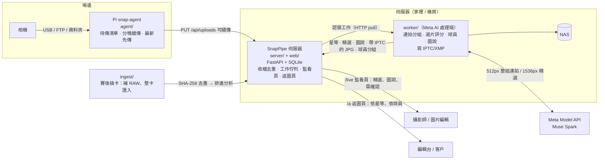

**繁體中文** | [English](README.en.md)

# SnapPipe

**體育新聞攝影的即時回傳系統。** 快門按下幾秒後，照片已經回到伺服器備份；Meta AI 把同一組連拍互相比較、選出決定性瞬間，讀出球衣號碼、對照名單，草擬通訊社格式的圖說並寫進 IPTC。編輯在網頁上確認、複製圖說就能發稿。

**一台伺服器（一個 LXC）= 一個拍攝計劃 = 一本相簿。** Pi 即時傳的、賽後插卡匯入的、跨過午夜拍的，全部進同一本，不會依日期拆開。要拍另一個計劃，就再建一個 LXC。

Meta Global AI Developer Hackathon 2026 參賽專案。設計與申請文件：

- [設計文件 Design Document（中文）](docs/DESIGN.md)
- [Application Draft（English）](docs/APPLICATION.md)
- [架構與協定（實作）](docs/ARCHITECTURE.md)



| 位置 | 元件 | 做什麼 |
|---|---|---|
| 相機旁 | `agent/` snap-agent（Raspberry Pi） | 發現新照片 → 待傳清單（SQLite）→ 1MB 分塊 PUT、可續傳、最新先傳；心跳回報狀態、接收「要進哪本相簿」。只轉送、不運算 |
| 伺服器 | `server/`（FastAPI + SQLite）、`web/`（Vue 3） | 收檔、SHA-256 去重、縮圖、工作佇列、即時監看頁、返圖頁、分享連結 |
| 任何機器 | `worker/` | 向伺服器認領工作 → 湊成連拍組 → Meta Model API 兩階段分析 → 寫 IPTC/XMP → 換上帶 metadata 的 JPG → 依球員分組 → NAS。可以和伺服器裝在同一台 |
| 任何機器 | `ingest/` | 賽後插卡：整卡複製、補 RAW、沒即時傳到的照片上傳並排進 Meta AI 分析（Mac 與 Linux） |

**目標：從快門到「可發稿的照片與圖說草稿」少於 60 秒。** 熱路徑（相機 → Pi → 伺服器 → 監看頁）完全不等 AI；AI 是非同步增強，結果回來再補上精選、星等與圖說。Meta API 慢或掛掉時，照片照常進監看頁。

## Meta AI 怎麼用

worker 的 `meta_ai` 分析器（`worker/analyzers/meta_ai.py`）呼叫 [Meta Model API](https://dev.meta.ai/docs/quickstart)（`muse-spark-1.3`，Chat Completions + 影像 + JSON Schema 結構化輸出），分兩階段：

| | 階段一：連拍比較選片 | 階段二：球員辨識與圖說 |
|---|---|---|
| 什麼時候 | 同一台相機、間隔 ≤ 0.5 秒的照片湊成一組；1.5 秒沒有新照片就送出 | 只做階段一選中的 1–3 張 |
| 送出 | 整組（最多 40 張）512px 縮圖，加上每張的時間差與本機銳利度 | 1536px 一張 + 比賽資料（賽事、場館、主客隊球衣顏色）+ 名單 |
| 拿回 | 最佳張、每張的 overall / peak / focus / composition 分數、問題（失焦、擋臉…）、動作類型 | 每位球員的隊伍、號碼、信心值、位置框；一句動作描述、標題、關鍵字 |
| 用在 | 星等、AI 精選（◆）、IPTC Urgency、`xmp:Label=Select` | 圖說、標題、`PersonInImage`、「依球員」分組 |

**防止 AI 編造事實（新聞倫理）**

- **模型不寫人名。** 描述裡只能用 `{P0}`、`{P1}` 指 players 陣列裡的人，worker 用名單查號碼後替換成「台北雄鷹隊王小明（#23）」；號碼不在名單上就寫「#23 球員」。模型若違規直接寫出人名，會標記需人工確認。
- **只有「誰在做什麼」那一句是 AI 寫的。** 日期、城市、場館、賽事、攝影師署名都由範本與比賽資料填入（`worker/games/`）。
- **需人工確認**：球員信心 < 0.8、主角號碼不在名單上、模型自己不確定時，監看頁標 ⚠ 並列出原因。
- **不做人臉辨識。** 身分只來自球衣號碼 + 名單。
- **人工把關。** AI 只產生草稿；編輯看過、複製圖說才發稿。
- **降級**：模型輸出格式錯就退回本機銳利度排序，照片照常完成；網路錯誤、429、5xx 整組退避重試。

**隱私**：預設用一般方案 `muse-spark-1.3`。**不要用 `-contributor` 方案**：那個方案下 Meta 可以拿你送出的照片與圖說訓練模型（worker 啟動時會警告）。送出的是縮小後的圖（512px / 1536px），不是原圖。

**成本**（2026-10 用 `muse-spark-1.3` 實測，Meta 公開牌價每百萬 token 輸入 $1.25、輸出 $4.25）：選片含標籤每張約 US$0.0014，圖說每張約 US$0.0071。圖說只在有拍攝計劃（或體育比賽資料）時寫，而且只替 5 星的精選寫。以一場 3,000 張估算：沒有計劃書（只有星等與標籤）約 US$4.1；有計劃書、約 100 張 5 星精選寫圖說，約 US$4.8。worker 會把每組的 token 用量記在伺服器的工作結果上；實驗紀錄在 `tests/meta_api/sets/saki/results/`。

## 需求

| 位置 | 需求 |
|---|---|
| 伺服器 | Debian 12 / Ubuntu 22.04+ 的 LXC、VM 或實體機（Python 3.10+），root |
| worker | Python 3.10+、[exiftool](https://exiftool.org)；Mac（Homebrew）或 Linux 都可以，也可以裝在伺服器同一台。需要 Meta Model API 金鑰 |
| 樹莓派 | Raspberry Pi OS Bookworm。**Pi Zero 2 W** 剛好（只轉送不運算，瓶頸是 2.4GHz Wi-Fi）。相機 USB 直連模式需要 libgphoto2 |
| 插卡電腦 | Mac 或 Linux，Python 3.10+、exiftool |
| 網路 | Pi 與 worker 要連得到伺服器：區網、WireGuard / Tailscale，或經反向代理的 HTTPS 網址；worker 要能連 `api.meta.ai` |
| NAS（選用） | SMB 共用資料夾 |

```bash
git clone https://github.com/normantaipei/SnapPipe.git
cd SnapPipe
```

## 建議安裝順序

依賴關係：**伺服器 → worker → 樹莓派**。伺服器先裝，因為另外兩台的 token 都是它產生的；Pi 最後裝，因為它一開機就會往伺服器傳。

| 步驟 | 裝置 | 做什麼 | 確認方式 |
|---|---|---|---|
| 1 | 伺服器 | 安裝（§1）；記下印出的上傳 token、裝置 token | 瀏覽器開 `http://<伺服器IP>:8080` 看到首頁；`snappipe-live status` 顯示「即時上傳：開啟」 |
| 2 | worker | 用 §1 安裝法 A 的話已經裝好在同一個 LXC（安裝時就問了 Meta API 金鑰）；裝在 Mac 或別台就跑 `worker/setup.sh`（§3）。寫比賽資料（§3） | `worker/worker.sh --status` 印出佇列；`tests/e2e/run.sh` 全部通過 |
| 3 | 插卡電腦（選用） | 貼上伺服器印出的 `ingest.sh … --save` 指令（§4） | `ingest/ingest.sh --servers` 顯示連線正常 |
| 4 | 樹莓派 | 一行安裝（§2），填伺服器網址與裝置 token | `snap_agent.py test` 回 OK；`worker.sh --status` 看得到這台裝置的心跳 |
| 5 | 全線 | 拍一組連拍 | `/live/<即時碼>` 幾秒內出現照片，再過幾秒補上 ◆ 精選與圖說 |

**比賽當天：**

1. **賽前**：一場比賽一台 LXC（安裝時填的拍攝計劃名稱就是相簿名稱，之後可用 `snappipe-live album <新名稱>` 改）。這場的比賽資料與名單就是拍攝計劃，寫在 `worker/games/default.toml / default.csv`。`[cameras]` 寫每台機身由誰拍，圖說署名會自動帶入。
2. **開賽**：worker 常駐（systemd / launchd）；Pi 開機自己連、自己傳；圖片編輯開 `/live/<即時碼>`，按「◆ 只看精選」。
3. **比賽中**：點開精選看圖說草稿；⚠ 的照片先核對姓名；按「複製圖說」貼到發稿系統。下載的 JPG 已經帶 IPTC 圖說、標題、人名、星等。
4. **賽後**：插卡跑 `ingest/ingest.sh` 補 RAW 與沒傳到的照片（已即時傳過的自動跳過、不重新分析）；`snappipe-live off` 關掉即時上傳。

## 1. 伺服器

裝完會印出 token 與 worker、Pi、插卡電腦要用的設定。重跑即更新，照片、資料庫、token 都保留。設定在 `/etc/snappipe.env`，忘記時在伺服器執行 `snappipe-cmd`。

**安裝法 A（Proxmox Shell 一行，建 LXC、裝好返圖站與 worker）**

```bash
curl -fsSL https://raw.githubusercontent.com/normantaipei/SnapPipe/main/deploy/create-lxc.sh | bash -s -- --install
```

一開始會問**拍攝計劃名稱**（一台 LXC 只放這個拍攝計劃，這也是唯一那本相簿的名稱）、磁碟大小、**對外網址**（反向代理的 https 網域，Pi 在外面上傳與分享連結用；沒有就留空）和 **Meta API 金鑰**（輸入時不顯示，當場向 Meta 驗證、不收費；沒通過會說原因並再問一次；**直接 Enter 留空 = 不用 AI，只當普通相簿**）。問完就不用守在旁邊：建容器、裝返圖站、在同一個容器裝好 worker 並設成開機常駐，全程不用進容器。

不想裝 worker（worker 要放 Mac 或別台）加 `--no-worker`；自動化可以用 `--meta-key <金鑰>` 或 `--no-ai` 免詢問。之後換金鑰、或當初留空現在要開 AI，同樣在 Proxmox Shell 一行：

```bash
curl -fsSL https://raw.githubusercontent.com/normantaipei/SnapPipe/main/deploy/create-lxc.sh | bash -s -- --set-key --id <容器編號>
```

更新（返圖站與 worker 一起，金鑰與照片都保留）：

```bash
pct exec <容器編號> -- bash -c 'curl -fsSL https://raw.githubusercontent.com/normantaipei/SnapPipe/main/bootstrap.sh | bash -s -- --no-prompt'
```

裝完最後會印出「下一步」：每台 Pi 的一行安裝指令（網址與 token 都填好）、**這本相簿現在就能用的連結**（返圖給客人、即時監看給攝影師；相簿在安裝時就建好了，還沒有照片也能先給）、賽後插卡指令與常用指令。忘了就在 Proxmox 執行 `pct exec <容器編號> -- /usr/local/bin/snappipe-cmd`；只要連結就用 `pct exec <容器編號> -- /usr/local/bin/snappipe-live links`。

**另一個拍攝計劃**：再跑一次上面的一行指令，建一台新的 LXC（自動用下一個容器編號）。每台各自一本相簿、各自的連結與拍攝計劃。

worker 的記錄：`pct exec <容器編號> -- journalctl -u snappipe-worker -f`。比賽資料放在容器裡的 `/opt/snappipe/src/worker/games/`。

**安裝法 B（現有的 Debian / Ubuntu 機器，以 root 執行）**

```bash
curl -fsSL https://raw.githubusercontent.com/normantaipei/SnapPipe/main/bootstrap.sh | bash
```

**安裝法 C（從自己的電腦打包，經 SSH 安裝；fork 成私有 repo 時用這個）**

```bash
ssh root@<PVE_IP> "bash -s -- --ssh-key '$(cat ~/.ssh/id_ed25519.pub)'" < deploy/create-lxc.sh   # 建 LXC（已有就跳過）
./deploy/build-installer.sh && scp dist/snappipe-install.sh root@<伺服器IP>:/tmp/ && ssh -t root@<伺服器IP> bash /tmp/snappipe-install.sh
```

fork 的人用環境變數 `SNAPPIPE_GIT`、`SNAPPIPE_REPO` 改成自己的 repo。

**即時上傳總開關**（在伺服器上執行，立即生效）：

```bash
snappipe-live off      # Pi 暫停上傳（照片留在卡上）、/live 關閉；返圖頁與插卡上傳照常
snappipe-live on
snappipe-live status   # 開關、裝置、佇列、相簿的返圖 / 即時監看網址
snappipe-live links    # 相簿的返圖 / 即時監看網址
snappipe-live album                    # 看相簿名稱
snappipe-live album Saki 外拍 10/30    # 改相簿名稱（可以有空白；連結不變）
```

相簿：一台伺服器只有一本，名稱是安裝時填的拍攝計劃名稱。Pi 給的相簿名稱、插卡的 `--album`、照片的拍攝日期都不會拆出別本。從舊版（依日期分相簿）更新時，會自動把所有相簿併成一本（照片最多的那本當主體），舊的返圖與即時監看連結會轉到合併後的相簿。真的需要舊行為，在 `/etc/snappipe.env` 加 `SNAPPIPE_SINGLE_ALBUM=0`。

Proxmox 上的容器可以 `pct exec <CTID> -- /usr/local/bin/snappipe-live off`；也可以在 worker 那台 `worker/worker.sh --live off|on`。

`/etc/snappipe.env` 裡和即時路徑有關的：

| 變數 | 說明 |
|---|---|
| `SNAPPIPE_DEVICE_TOKENS` | `名稱:token`，多台 Pi 用逗號分隔。要加 Pi 就多寫一組再 `systemctl restart snappipe` |
| `SNAPPIPE_WORKER_TOKEN` | 預設留空 = 區網信任模式：worker 與管理 API 對區網直連開放、不用 token。worker 要從外面經 VPN / 反向代理連回來才填 |
| `SNAPPIPE_UPLOAD_TOKEN` | 插卡 ingest 與管理指令用（只能從區網直連） |
| `SNAPPIPE_DEVICE_NETS` / `SNAPPIPE_WORKER_NETS` | 選填，限制來源網段（CIDR） |
| `SNAPPIPE_JOB_LEASE`、`SNAPPIPE_JOB_MAX_ATTEMPTS` | 工作租約秒數（600）、失敗幾次標 dead（5） |
| `SNAPPIPE_LIVE_WINDOW` | 相簿最後更新後多久內返圖頁還會自動輪詢（900 秒） |

## 2. 樹莓派 snap-agent

伺服器裝完最後會印出每台 Pi 的一行安裝指令（網址與裝置 token 都填好了），直接貼到 Pi 上執行；忘了就在伺服器執行 `snappipe-cmd`（Proxmox：`pct exec <容器編號> -- /usr/local/bin/snappipe-cmd`）。指令長這樣：

```bash
curl -fsSL https://raw.githubusercontent.com/normantaipei/SnapPipe/main/agent/bootstrap.sh | sudo bash -s -- \
  --url http://<伺服器IP>:8080 --token <裝置token> --name pi-1 --mode gphoto2
```

`--mode` 填 `gphoto2`（相機 USB 接 Pi）、`ftp`（Pi 開 FTP 給相機連，印出相機要填的帳密）或 `watch`；`--send-raw` 讓 RAW 也傳。重跑同一行就是更新。設定檔在 `/etc/snap-agent.toml`（範本 `agent/config.example.toml`）。

| mode | 適合 | 說明 |
|---|---|---|
| `gphoto2` | 沒有 FTP 功能的相機 | 相機 USB 接 Pi，設成 PC 遙控 / PTP、照片存記憶卡（Sony：儲存目的地「PC+相機」）。監聽 `FILE_ADDED`，當下把檔案讀進 Pi 的暫存區再上傳；相機關機、拔線、Pi 重開機都不會掉已收到的照片 |
| `ftp` | 內建 FTP 的相機（Sony、Canon、Nikon 多數機身） | Pi 開 FTP（預設 2121）給相機連，收到就轉送。相機 ↔ Pi 是純 FTP，只在相機和 Pi 之間 |
| `watch` | 其他任何方式 | 看一個資料夾，有新 JPG 就傳 |

**記憶卡是最終的保險**：Pi 只記「哪些還沒傳」，斷線、重開機都接著傳，最新的先傳。建議相機設 JPG M / S（約 2–5MB）即時傳，RAW 留在卡上賽後補；`send_raw = true` 時 RAW 排在所有 JPG 之後、安靜期才傳，有新 JPG 會立刻讓路。

連拍分組靠 EXIF 的拍攝時間（含毫秒）與機身序號。Sony 的 JPG 不一定寫序號，gphoto2 模式會由 Pi 經 PTP 讀序號補上；沒有序號時以 Pi 為單位分組。

常用指令（`sudo -u snap /opt/snap-agent/.venv/bin/python /opt/snap-agent/snap_agent.py …`）：`status`、`album <相簿>` / `album --clear`、`retry`、`send a.jpg`、`test`。選用的狀態螢幕：0.96 吋 SSD1306 OLED（`type = "oled"`，接線見 `agent/display.py` 開頭）或 Waveshare 1.44 吋 LCD HAT（`type = "lcd144"`，直接插 40pin，背光會自動變暗、關閉，只有出狀況或按鍵才亮，見 `agent/display_lcd.py` 開頭）。Waveshare UPS HAT (C) 的電量填 `battery_cmd = "ina219:1:0x43"`。

## 3. worker（Meta AI 處理端）

用 §1 安裝法 A 的話 worker 已經裝在同一個 LXC、設好開機常駐，這節的安裝步驟可以跳過（設定檔在容器裡的 `/opt/snappipe/src/worker/.env`）。worker 要裝在 Mac 或別台機器時：

```bash
cd worker && ./setup.sh                # 建 venv、裝 exiftool；建立 .env 與 games/default.toml；問 Meta API 金鑰
nano .env                              # SERVER_URL
./worker.sh                            # 常駐；Ctrl-C 停
./worker.sh --once                     # 把目前佇列處理完就結束
./worker.sh --status                   # 伺服器的佇列、裝置、相簿與即時監看網址
```

**Meta API 金鑰**：`setup.sh` 會問你（輸入時不顯示），先向 Meta 驗證（查詢模型的端點，不收費），確認金鑰有效、模型可以用才存進 `.env`；沒通過會說原因（金鑰錯誤、找不到模型…）並請你再輸入一次。Meta 沒有查付款狀態的 API，所以**還沒綁信用卡要到第一次分析才會發現**：worker 記錄會寫「帳號還沒設定付款或額度用完」，照片照常進相簿（星等與精選改用本機銳利度估計、不寫圖說），到 dev.meta.ai 的 Billing 頁補好後下一組就恢復。**直接按 Enter 留空就不用 AI**：`ANALYZER=none`，照片照常即時進相簿、可以瀏覽與下載，只是不評分、不選片、不寫圖說，當普通相簿用。

```bash
./setup.sh --ask-key                   # 換金鑰 / 之後才要開 AI
./setup.sh --api-key <金鑰>             # 自動化安裝：直接帶（也可以設環境變數 META_API_KEY）；沒通過就停下
./setup.sh --no-ai                     # 不用 AI
```

不是在終端機裡執行（systemd、自動化腳本）又沒帶金鑰時，一樣會設成不用 AI，之後在終端機跑 `./setup.sh --ask-key` 就能開。worker 也會讀環境變數 `META_API_KEY`（優先於 `.env`）。

開機常駐：Linux 用 `worker/snappipe-worker.service`（systemd，說明在檔案開頭）；Mac 用 `worker/launchd/com.snappipe.worker.plist`。和伺服器裝在同一台時 `SERVER_URL=http://127.0.0.1:8080`。

`.env` 重點（完整說明在 `worker/.env.example`）：

| 變數 | 預設 | 說明 |
|---|---|---|
| `SERVER_URL` | | 一台或多台（逗號分隔） |
| `META_API_KEY` | | [dev.meta.ai](https://dev.meta.ai) 後台 → API keys；`setup.sh` 會問並驗證。只放在 `.env`（權限 600、已在 `.gitignore`） |
| `META_MODEL` | `muse-spark-1.3` | 不要用 `-contributor`（資料會被拿去訓練） |
| `META_REASONING` | `low` | `minimal` / `low` / `medium` / `high`；越高越慢越貴 |
| `META_CONCURRENCY` | 4 | 同時送出幾組連拍 |
| `BURST_GAP_SEC` / `BURST_IDLE_SEC` / `BURST_MAX` | 0.5 / 1.5 / 40 | 連拍分組：間隔、幾秒沒新照片就送出、一組最多幾張 |
| `CAPTION` / `MAX_PICKS` | 1 / 3 | 是否做階段二；每組最多選幾張 |
| `PICK_MIN_SCORE` | 4 | 第二、三名精選的最低分；整組都不好時只留第一名 |
| `CAPTION_MIN_STARS` | 5 | 有拍攝計劃時，只替這個星等以上的精選寫圖說（0 = 每張精選都寫） |
| `REVIEW_CONF` / `PLAYER_MIN_CONF` | 0.8 / 0.7 | 低於前者要人工確認；達到後者才放進「依球員」分組 |
| `SCORE_WEIGHTS` / `STAR_THRESHOLDS` | `0.65,0.25,0.10` / `4,5.5,7,8.5` | 分數融合權重；1–10 分換成 1–5 星的門檻 |
| `RATING_OVERWRITE` | 0 | 0 = 相機內評過的星等優先 |
| `WRITE_IPTC` / `UPLOAD_TAGGED_JPG` | 1 / 1 | 寫 IPTC/XMP，並把寫好的 JPG 換上伺服器 |
| `ANALYZER` | `meta_ai` | 也可以 `remote_http`（POST 給你自己的服務）或 `none`（不用 AI，當普通相簿；`setup.sh` 金鑰留空時就是這個） |
| `NAS_SMB` | | Mac 會自動掛載 `smb://…`；Linux 先 `mount -t cifs` 再填掛載路徑 |

### 比賽資料（`worker/games/`）

**拍攝計劃就是 `default.toml`**（一台一本相簿，所以只有這一份；名單放 `default.csv`）。拍攝中改檔案會自動重新載入。範本：`general.toml`（一般攝影）、`example.toml` / `example.csv`（體育）。在 Proxmox 上編輯：`pct exec <容器編號> -- nano /opt/snappipe/src/worker/games/default.toml`。

**三種模式（自動判斷）**：

- **一般攝影**（預設）：`default.toml` 裡沒有賽事、主客隊、名單，也沒有 `notes` / `[[people]]`。AI 依對焦、表情、構圖選片，**只給星等與標籤**（選片時順便產生，例：藍色假髮、紅色紙傘、石橋、涼亭），不寫圖說。`setup.sh` 會從 `games/general.toml` 建這份；`[game] subject` 可以寫拍攝題材給 AI 參考。
- **一般攝影 + 拍攝計劃**（選用）：在 `default.toml` 打開 `notes`（道具、場景）與 `[[people]]`（名字、角色、外觀），才寫圖說，而且只替 5 星的精選寫（`CAPTION_MIN_STARS`）。AI 只回報「畫面裡的人符合第幾個人的外觀」，名字由系統填入（和體育名單同一個原則，名字不送給 AI）。實測（Saki 30 張）：名字正確 25/26、不會硬套沒出現的人、中式服裝不再被寫成「和風」；道具細節仍要人工確認。
- **體育**：照 `example.toml` 的格式在 `default.toml` 填好賽事（`event`）、主客隊或名單（或直接把 `example.toml` 複製成 `default.toml` 再改），才用體育新聞的標準選片並寫圖說。

舊版安裝把籃球範本直接當成 `default.toml`，導致每本相簿都被寫成那場比賽的圖說；更新時若 `default.toml` 還是範本原樣，會自動換成一般攝影。

```toml
[game]
sport = "basketball"
event = "2026 城市聯賽"
home = "台北雄鷹"
away = "新竹獵豹"
home_color = "白底紅字"        # 模型靠球衣顏色分主客隊
away_color = "深藍底白字"
venue = "台北體育館"
city = "台北"
country = "台灣"
lang = "zh"                   # 圖說語言：zh / en
creator = "攝影師署名"
credit = "SnapPipe"

[cameras]                     # 機身序號（完整或末幾碼）= 本場攝影師；同型號兩台也分得開
"5530" = "李攝影"
```

```csv
team,jersey,name,position
home,23,王小明,F
away,11,林志強,C
```

產出的圖說（範本可用 `caption_template` 改，英文有 AP 格式）：

> 台北，2026 年 10 月 30 日 — 台北雄鷹隊王小明（#23）在新竹獵豹隊林志強（#11）防守下灌籃得分。此為2026 城市聯賽台北雄鷹與新竹獵豹之戰，地點為台北體育館。（攝影：李攝影／SnapPipe）

沒有比賽資料時照樣選片評分；圖說只有動作描述與署名，而且不會出現任何人名。名單與署名只留在本機（`worker/games/` 已在 `.gitignore`，範本除外）。

### 寫進 JPG 的 metadata

`Headline`、`Caption-Abstract` / `dc:description`、`Keywords` / `dc:subject`、`Iptc4xmpExt:PersonInImage`、`Event`、`City`、`Sub-location`、`Country`、`By-line`、`Credit`、`Copyright Notice`、`xmp:Rating`、`Urgency`（9 分以上 1、7–9 分 3、其餘 5）、精選加 `xmp:Label=Select`。Photo Mechanic、Lightroom 與通訊社 CMS 都直接讀得到。

## 4. 賽後插卡（ingest）

指令由伺服器安裝時印出（`--save` 會記住連線設定）：

```bash
ingest/ingest.sh --server http://<伺服器IP>:8080 --token <上傳token> --save   # 第一次
ingest/ingest.sh --album 2026_10_30_hawks --title "城市聯賽 雄鷹 vs 獵豹"        # 插卡後
ingest/ingest.sh --resume 2026_10_30_hawks                                    # 中斷後接著做
```

流程：複製到暫存區（邊複製邊算 SHA-256）→ 讀 EXIF（只有 RAW 的照片用 exiftool 抽出相機內嵌的 JPG）→ 上傳並排進 Meta AI 分析（`--no-analyze` 只上傳）→ rsync 到 NAS 並比對。現場已經經 Pi 傳過的同一張（內容 SHA-256 相同）不重傳、不重新分析，只補 RAW；卡上照片和現場照片會湊進同一組連拍一起比較。NAS 上現場的副本在插卡備份完成後自動刪除，不會重複。

記憶卡自動偵測：Mac 的 `/Volumes`、Linux 的 `/media/<使用者>`、`/run/media/<使用者>`；也可以 `--card <路徑>`。

## 兩種頁面

**即時監看頁 `/live/<即時碼>`（給攝影師與圖片編輯，不要給客戶）**：照片依拍攝時間即時流出（每 3 秒增量抓取）。分析完補上星等、◆ AI 精選與 ⚠ 需人工確認；「◆ 只看精選」只留每組連拍選出的幾張。點開看標題、圖說草稿、球員（號碼、姓名、信心值、是否對上名單）與需確認的原因，按「複製圖說」。上方是每台 Pi / 相機的傳輸狀態：連線、待傳、每分鐘張數、電量、進行中的上傳。

**返圖頁 `/a/<相簿碼>`（給編輯台或客戶）**：依星等排序，可篩「AI 精選」、動作類型、球員、關鍵字；「依球員」分組（`/f/<碼>` 某位球員的所有照片）；下載 JPG（帶 IPTC）/ RAW；`/p/<單張碼>` 單張分享。

即時碼與相簿碼從 `worker.sh --status` 或 `snappipe-live status` 取得。

## 後端 API（即時路徑）

| 身分 | Method | Path | 說明 |
|---|---|---|---|
| 裝置 | POST | `/api/devices/heartbeat` | 回報狀態；回傳指定的相簿 |
| 裝置 | HEAD / PUT | `/api/uploads/{upload_id}` | 可續傳分塊上傳，收滿即入庫並排工作 |
| worker | POST | `/api/jobs/claim` | 認領工作（租約到期自動釋放） |
| worker | GET / PUT | `/api/jobs/{id}/file` | 下載原圖 / 換上寫好 metadata 的 JPG |
| worker | POST | `/api/jobs/{id}/result` | 回寫星等、標籤、`headline`、`caption`、`ai`（精選、動作、連拍、球員、需確認…） |
| worker | POST | `/api/jobs/{id}/fail`、`…/heartbeat` | 失敗（退避重排）/ 延長租約 |
| worker | PUT | `/api/worker/albums/{slug}/people` | 依球員分組（`label` 例「#23 王小明」） |
| 上傳 token | PUT | `/api/albums/{slug}/photos` | 插卡上傳；meta 帶 `"analyze": true` 就排進分析（優先權低於現場） |
| 管理 | GET | `/api/live/status` | 裝置、佇列、相簿（含即時碼）、dead 工作 |
| 即時碼 | GET | `/api/live/feed/{live_key}?since=` | 監看頁資料（照片含 `headline`、`caption`、`ai`） |
| 管理 | PUT | `/api/live/devices/{name}`、`/api/live/switch` | 指定裝置的相簿 / 即時上傳總開關 |
| 管理 | POST | `/api/live/albums/{slug}/reprocess`、`/api/live/jobs/{id}/retry` | 整本重跑（改了名單或模型後）/ 單件重試 |

協定細節與資料表見 [docs/ARCHITECTURE.md](docs/ARCHITECTURE.md)。

## 本機測試

**端到端（不需要 Meta 金鑰）**：`tests/e2e/run.sh` 會啟動一個模擬的 Meta Model API（檢查請求格式、第一次故意回 429）、伺服器，產生兩台相機的測試照片（A 機 5 張連拍、B 機 2 張單張）用 Pi 的協定上傳，跑 `worker.py --once`，最後檢查：連拍分組、精選、名單填名、範本與署名、需確認、球員分組、JPG 內的 IPTC、送給 API 的縮圖尺寸。`PLAIN=1 tests/e2e/run.sh` 改用不用 AI 的設定（`ANALYZER=none`），確認照片照常進相簿、可以下載、完全不呼叫 Meta。

```bash
tests/e2e/run.sh
```

要看畫面：先 `cd web && npm ci && npm run build`，再 `KEEP=1 tests/e2e/run.sh`，開印出的 `/live/…` 網址。

**Meta API 實測（真的照片、真的 API）**：`tests/meta_api/` 從返圖站挑幾組連拍，抹掉所有 metadata（星等、標籤、EXIF 都清掉，畫素先轉正，檔名改流水號），再用正式版的分析器呼叫 Meta Model API，報告選片和參考星等 / 你自己的選擇一致到什麼程度、延遲、token 與費用。照片只留在本機（已在 `.gitignore`）。

```bash
tests/meta_api/run.sh prepare --album "https://<返圖站>/a/<分享碼>" --set saki --auto 6   # 或 --groups DSC08979-DSC08983 …
tests/meta_api/run.sh run --set saki --dry-run       # 只檢查 metadata，不呼叫 API
tests/meta_api/run.sh run --set saki                 # 金鑰讀 META_API_KEY 或 worker/.env；報告在 sets/saki/results/<時間>/report.md
```

**整條線接真的 Meta API**：在 `worker/.env` 填 `META_API_KEY`，伺服器照 §1 或下面這樣在本機跑，丟幾張比賽照片進去：

```bash
cd server && python3 -m venv .venv && .venv/bin/pip install -r requirements.txt && cd ..
SNAPPIPE_DATA=/tmp/sp-data SNAPPIPE_UPLOAD_TOKEN=admin SNAPPIPE_DEVICE_TOKENS=pi-test:dev \
  server/.venv/bin/uvicorn app.main:app --app-dir server --port 8765
```

```bash
# 另一個終端：插卡流程把一個資料夾當記憶卡（裡面要有 DCIM/）
ingest/ingest.sh --card ~/Desktop/test-card --album 2026_10_30_test --no-eject --skip-nas \
  --server http://127.0.0.1:8765 --token admin
SP_SERVER_URL=http://127.0.0.1:8765 worker/worker.sh --once
```

## 和 Mac 本地版的差異

這個 repo 是 SnapPipe 的 Meta AI 版。拍攝端、伺服器、上傳協定、工作佇列與返圖站沿用本地處理版，處理端換成 Meta Model API：

| | 本地版 | Meta AI 版 |
|---|---|---|
| 分析 | Mac 的 macOS Vision（Prism）：標籤 + 美學分數，一張一張看 | Meta Model API：整組連拍互相比較選片，讀球衣號碼、寫圖說 |
| 處理端 | 只能在 Mac 上跑 | Mac、Linux、伺服器本機都能跑 |
| 人物分組 | 人臉辨識（InsightFace）+ 服裝 | 球衣號碼 + 名單，不做人臉辨識 |
| 產出 | 星等、標籤 | 星等、AI 精選、動作類型、標題、圖說草稿、球員、需人工確認 |
| 插卡匯入 | Mac 上用 Prism 標籤後上傳 | 上傳後排進伺服器佇列，和現場照片一起由 Meta AI 分析 |

## 尚未實作（設計文件有、程式還沒有）

- 伺服器端的 FTP / FTPS 接收端（設計 §6.2 模式 A、B）：目前相機的 FTP 要先連到 Pi（`ftp` 模式），由 Pi 轉送。
- 開賽前拍時鐘 QR 校正相機時間（§7）：目前直接用相機 EXIF 時間。
- 編輯檯的一鍵發稿（FTP / CMS webhook）、鍵盤挑片、改選同組其他張、AI 建議裁切（§10）：目前是複製圖說、下載帶 IPTC 的 JPG。
- 跨相機的「同一瞬間」多角度卡片（§7.6）。
- 實作用 SQLite + HTTP pull 佇列，不是設計文件寫的 PostgreSQL + Redis/arq；單場的量用不到。

## 安全與隱私

- **上傳端口**：每台 Pi 一組 token（常數時間比對）；連續錯 20 次封 10 分鐘；副檔名白名單 + 檔頭特徵檢查；檔名只留安全字元、存檔以 SHA-256 內容定址；單檔與單段大小上限、磁碟保留空間、每台裝置同時上傳數上限；總開關 `snappipe-live off`。
- **三種身分**：裝置 token 只能上傳與心跳；worker 與管理 API 預設區網直連免 token（設了 `SNAPPIPE_WORKER_TOKEN` 才驗）；插卡上傳 token 限區網直連。區網信任模式的前提是信任家裡網路上的每台裝置。
- **送到 Meta 的資料**：只有縮小後的照片（512px / 1536px）與比賽資料、名單；用一般方案，不用會拿資料訓練的 contributor 方案。原圖、RAW 不離開自己的伺服器與 NAS。
- **API 金鑰**只放在 `worker/.env`（權限 600，不進 git）；`setup.sh` 輸入時不顯示，也不經過指令參數傳給驗證程式。
- **不做人臉辨識**；「依球員」分組只來自名單上的號碼，伺服器只存分組結果與代表照上的位置框。
- 分享連結即權限，對外請用 HTTPS。

## 授權

MIT
