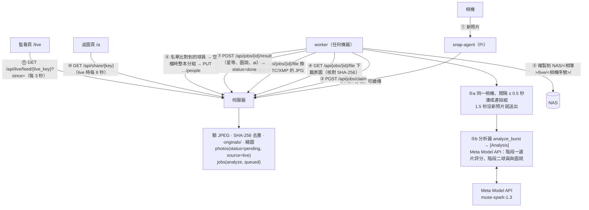

# SnapPipe 架構（Meta AI 版）

## 1. 資料流



熱路徑是 ①②：照片幾秒內就在監看頁看得到；③–⑨ 是非同步增強，worker 或 Meta API 掛了照片也不會丟，起來再接著做。

## 2. 元件職責

| 元件 | 有狀態？ | 職責 | 不做什麼 |
|---|---|---|---|
| snap-agent | 待傳清單 SQLite + 暫存區（gphoto2 / ftp 模式收到的檔，傳完刪） | 發現、收下、排隊、分塊上傳、心跳 | 不解碼、不算分。gphoto2 模式必須當下把檔讀進 SD 卡：PC Remote 推來的是暫時物件，相機關機就沒了；暫存區剩不到 `spool_min_free_mb` 時只收 JPG |
| 伺服器 | SQLite + originals/ + derived/ | 收檔去重、佇列、返圖站 | 不做影像分析（可以換成任何處理端） |
| worker | state.db（已處理清單、每張照片的球員） | 湊連拍組、呼叫 Meta API、寫 IPTC、回寫、依球員分組、NAS | 不對外開 port；多個 worker 可並存；不做人臉辨識 |

## 3. 上傳協定（Pi → 伺服器）

- 身分：`Authorization: Bearer <裝置 token>`；token → 裝置名（`SNAPPIPE_DEVICE_TOKENS`）。
- `upload_id`：Pi 自訂，`sha256(裝置|機身序號|來源路徑|大小|mtime)[:40]`。同一張重送同一個 id，伺服器冪等。
- `HEAD /api/uploads/{id}` → `Upload-Offset`、`Upload-Length`、`Upload-Complete`；沒看過的 id 回 404（從 0 開始）。
- `PUT /api/uploads/{id}`，`Content-Range: bytes S-E/T`，body 是那一段。
  - 第一段（S=0）要帶 `X-SnapPipe-Album`、`X-SnapPipe-Filename`；選帶 `X-SnapPipe-Camera`、`X-SnapPipe-Taken-At`、`X-SnapPipe-Album-Auto: 1`（相簿是用檔案日期猜的，伺服器讀到 EXIF 拍攝日期就改用它）。
  - S ≠ 已收到的 byte 數 → `409` + `Upload-Offset`，Pi 照它的 offset 繼續。
  - 一段中途斷線 → 伺服器把那段截掉、回 400 + `Upload-Offset`，Pi 重送該段。
  - 收滿 → 驗證是 JPEG（含 Sony 的 MPO）、算 SHA-256、存檔、建相簿（不存在時）、入庫、排工作 → `{"complete": true, "photo_id", "duplicate", "album", "share_url"}`。
  - 同內容已在相簿裡 → `duplicate: true`，不動既有結果、不重排工作。
- 暫存檔在 `DATA/tmp/uploads/<id>.part`；`uploads` 表記錄進度。
- 上限：`SNAPPIPE_UPLOAD_MAX_MB`（256）、單一 PUT 16MB；磁碟剩餘 < `SNAPPIPE_MIN_FREE_GB` 回 507；每裝置進行中 ≤ `SNAPPIPE_MAX_INFLIGHT`；48 小時沒傳完的暫存清掉。
- **Pi 端排序**：`ORDER BY kind='raw', mtime DESC`——有 JPG 就先傳 JPG；RAW 每傳完一段就 `discover()` 一次，發現有 JPG 待傳就 return 讓路（offset 已記在待傳清單，續傳時先 HEAD 核對伺服器 offset）。
- **RAW**：同一端口，依副檔名分流（`uploads.kind`）。收滿後核對檔頭（TIFF `II*\0`/`MM\0*`、CR3 `ftypcrx`、RAF `FUJIFILMCCD-RAW`、ORF、RW2），存到 `originals/` 後配對同一裝置的 JPG：同檔名 stem → 拍攝時間最接近且 ±2 秒內（從 TIFF 結構的 RAW 直接讀 EXIF DateTimeOriginal；相機經 PTP 推來的檔名是 `capt0000.jpg` / `capt0001.arw` 流水號，只能靠時間）→ 最近 2 分鐘內沒 RAW 的那張（`photos.raw_sha/raw_name/raw_bytes`），並排 `backup_raw` 工作給 worker 抄到 NAS。JPG 還沒到就先放 `raw_pending`，JPG 入庫時配對；Pi 用日期猜的相簿和 JPG 依 EXIF 入的不同也沒關係，配對以裝置 + 檔名為準（明確指定相簿時限該相簿）。
- 檔名：`safe_filename()` 只留 `[\w.-]`；不在白名單的副檔名回 415。
- token 錯誤：同一 IP 連續 20 次封 10 分鐘（每個 uvicorn worker 各自計數；成功一次即重置）。

## 4. 工作協定（處理端 ↔ 伺服器）

- 身分：伺服器 `SNAPPIPE_WORKER_TOKEN` 留空 = 區網信任模式，只接受 `SNAPPIPE_WORKER_NETS`（預設同 `SNAPPIPE_UPLOAD_NETS`）直連且不經代理的請求，不用 token；設了就要 `Authorization: Bearer <worker token>`。管理 API（`/api/live/*`）接受上傳 token 或 worker 身分。
- `POST /api/jobs/claim {"worker": "desk-1", "max": 16}` → `{"jobs": [...], "lease_sec": 600}`。
  每件：`id, kind, album, photo_id, sha256, filename, taken_at, camera, device, width, height, file_url, attempts`。
  伺服器先把過期租約放回 queued，再依 `priority DESC, created_at` 派發；兩個 worker 同時來不會拿到同一件（SQLite 寫入交易）。
- `GET /api/jobs/{id}/file` 原圖；`PUT /api/jobs/{id}/file`（multipart `file` + `meta={"sha256"}`）換 JPG：`photos.sha256` 改成新檔、縮圖重做、`photo_id` 不變、舊檔沒人用就刪。
- `POST /api/jobs/{id}/result {"stars", "aesthetic", "tags", "taken_at"?, "camera"?, "headline"?, "caption"?, "ai"?, "processor", "extra"}` → photo done。
  `ai` 原樣存進 `photos.ai`（JSON），監看頁與返圖頁直接拿來顯示：
  `{"pick", "rank", "moment", "moment_label", "score", "scores": {overall, peak, focus, composition}, "issues", "burst": {"id", "n", "index"}, "sharpness", "players": [{"team", "jersey", "name", "confidence", "role", "box", "verified"}], "needs_review", "review_reasons", "urgency", "ai_failed"?}`。
  `extra` 存在工作上：模型、prompt 版本、這組花的秒數、token 用量（只記在每組第一張）。
- `POST /api/jobs/{id}/fail {"error", "retry"}` → 退避 `min(30·2^attempts, 900)` 秒後重排；`attempts ≥ SNAPPIPE_JOB_MAX_ATTEMPTS` 或 `retry=false` → `dead`、photo `failed`。管理端可 `retry` / `reprocess`。
- `POST /api/jobs/{id}/heartbeat` 延長租約（分析一張超過租約時用）。
- 工作種類：`analyze`（分析 JPG）、`backup_raw`（RAW 到了：`GET /api/jobs/{id}/raw` 下載、抄到 NAS；`result` 只標完成，不動照片的分析結果）。worker 認領時帶 `kinds`。
- `PUT /api/worker/albums/{slug}/people` 人物分組，格式同返圖站：`{"people": [{"photos": [photo_id…], "cover": {"photo_id", "box": [x,y,w,h]}, "label": "#23 王小明"}]}`；分享碼沿用照片重疊最多的舊分組，有 `label` 就更新名稱。
- 插卡上傳 `PUT /api/albums/{slug}/photos` 的 meta 帶 `"analyze": true`（與 `"camera"`）時，照片設成 pending 並排 `analyze` 工作，優先權 -1（現場即時的是 0）。

任何語言都能照這個協定寫處理端；worker 只是其中一個實作。

## 5. 分析器介面（worker 內）

`worker/analyzers/base.py`：

```python
class Analyzer:
    name = "..."
    wants_bursts = False                                    # True：worker 先湊好連拍組再交給 analyze_burst
    def analyze(self, path: Path, job: dict) -> Analysis
    def analyze_burst(self, items: list[(Path, dict)]) -> list[Analysis]   # 預設逐張呼叫 analyze
Analysis(stars, aesthetic, tags, taken_at, camera, headline, caption, ai, players=[Player(key, label, box, confidence)],
         file_modified, extra)
```

- 內建：`meta_ai`（Meta Model API，`wants_bursts=True`）、`remote_http`（POST 多部表單，回 JSON）、`none`。
- `file_modified=True` 表示已把 metadata 寫進檔案（exiftool），worker 會把它換上伺服器。
- `players` 是名單比對過、信心 ≥ `PLAYER_MIN_CONF` 的球員；worker 存在本機 state.db，空檔時整本相簿分組送出。

### 5.1 連拍分組（worker）

認領到的 analyze 工作下載後放進緩衝區，鍵是（相簿, 相機序號或 Pi 名稱）。依拍攝時間（到毫秒）排序，間隔 > `BURST_GAP_SEC` 就斷成兩組。一組在以下任一情況送出：後面已經有同一台相機更晚的照片、`BURST_IDLE_SEC` 秒沒有新照片進來、滿 `BURST_MAX` 張。分析在執行緒池裡跑（`META_CONCURRENCY`），主迴圈照常認領與回寫；分析超過 4 分鐘會替整組延長租約。插卡上傳的照片和現場傳的同一台相機照片會湊進同一組。

### 5.2 Meta AI 分析器（`analyzers/meta_ai.py`）

1. 每張縮到 512px，算本機銳利度（灰階拉普拉斯變異數，除以組內最大值）。
2. **階段一**：整組一次送出（每張前面一行「Frame i: +0.12s, local sharpness 0.73」），JSON Schema 要求 `best`（1–3 張）、`moment`、每張的 `overall / peak / focus / composition / issues`。
3. `final = 0.65 × overall + 0.25 × peak + 0.10 × 10 × 銳利度 − 問題扣分`，夾在 1–10；換成星等（門檻 4 / 5.5 / 7 / 8.5）與 Urgency（≥9 → 1、≥7 → 3、其餘 5）。相機內評過的星等優先。
4. **階段二**：選中的幾張平行送出 1536px + 比賽資料 + 名單。模型回報球員的隊伍、號碼、信心、位置框，`action_sentence` 與 `headline` 只能用 `{P0}`、`{P1}` 指人。
5. 後處理：(隊伍, 號碼) 查名單得到姓名並替換佔位；不在名單、信心 < `REVIEW_CONF`、模型直接寫出名單上的人名 → `needs_review`。中文拿掉佔位兩邊多的空白。圖說 = 範本（日期、城市、賽事、場館、署名）+ 動作描述。
6. exiftool 寫 IPTC/XMP（欄位見 README）。

錯誤：HTTP 429 / 5xx / 連線錯誤在用戶端退避重試（照 `Retry-After`），用完次數就整組回報 `fail`（伺服器退避重排）；輸出不是合法 JSON 重送 2 次，仍失敗就退回本機銳利度排序並標 `ai_failed`，照片照常完成；階段二失敗只影響那一張的圖說。

## 6. 資料表（伺服器，新增的）

```
devices(name PK, active_album, last_seen, last_ip, stats JSON, uploads)
uploads(id PK, device, album, filename, total, received, camera, taken_at, album_auto, started_at, finished_at, photo_id)
jobs(id, kind, photo→photos.id, album_id, status queued|leased|done|dead, priority, attempts, worker,
     lease_until, not_before, error, result JSON, created_at, updated_at; UNIQUE(photo, kind))
photos 新增：status pending|done|failed、source card|live、device、camera、headline、caption、ai（JSON）
albums 新增：updated_at
```

worker 本機 `WORK_DIR/state.db`：`photos`（已處理、本機路徑）、`players`（照片 × 球員：key、label、位置框、信心）、`albums`（people_dirty）。

## 6b. 即時監看頁的資料來源

`/api/live/feed/{live_key}` 每 3 秒一次，`since` 帶上次的 `server_time`：照片只回 `photos.updated_at > since` 的（新入庫、分析完成、換檔、失敗都會更新 `updated_at`），前端以 `pk` 合併；裝置、相機、佇列每次整包回。
裝置狀態來自 `devices`（心跳：待傳、失敗、電量、模式、相機型號、FTP 連線數）、`photos`（本相簿張數、最後一張、最近一分鐘張數）與 `uploads`（進行中的上傳與進度）。
相機身分 = `photos.camera`（EXIF BodySerialNumber，伺服器入庫時讀）；沒有就以 Pi 名稱代替。

## 6b2. 縮圖與原圖

| 種類 | 尺寸 | 用途 | 網址 key |
|---|---|---|---|
| `s` | 長邊 400 webp q75 | 即時監看頁格子 | `photo_id` |
| `t` | 長邊 800 webp q80 | 返圖頁 justified 列表 | `photo_id` |
| `p` | 長邊 2048 jpg q86 | 燈箱、單張頁、OG 卡片、人物頭像 | `photo_id` |
| `o` / `r` | 原檔 | 下載 | `sha256` / `raw_sha` |

`photo_id` = 原始檔（Pi 或記憶卡上那份）的 SHA-256，是照片的身分；`sha256` 是目前存放的 JPG（worker 寫完 IPTC/XMP 換檔後會變）。縮圖以 `photo_id` 命名，換檔時 `make_derivatives()` 看到已存在就不重做，前端網址也不變（`Cache-Control: immutable`）。媒體路由 `(photo_id=? OR sha256=?)` 兩種都接受。舊資料庫啟動時 `migrate_derivatives()` 把 sha 命名的縮圖搬到 photo_id 名稱。

## 6c. 即時上傳總開關

`settings` 表的 `uploads_enabled`（預設開）。`snappipe-live off` / `PUT /api/live/switch` 寫入後：
- `PUT /api/uploads/*` 回 503 + `Retry-After`，Pi 的心跳拿到 `enabled: false` 後暫停派送（照片留在卡上，開回來接著傳）。
- `/api/live/feed`、`/lm/*` 回 403，`/live/<碼>` 頁顯示「即時監看已關閉」。
- 返圖頁、插卡上傳、worker 處理已入列的工作都不受影響。

## 7. 相簿歸屬

優先順序：管理端指定該裝置的相簿（`PUT /api/live/devices/{name}`，Pi 心跳時拿到）→ Pi 本機 `album` 指令 → Pi 設定檔 → EXIF 拍攝日期 `YYYY_MM_DD`。
相簿不存在時伺服器自動建（標題 = 相簿名，可之後由 ingest `--title` 改）。

## 8. 延遲（Pi 與伺服器為本地版實測，區網、JPG 6MB）

| 步驟 | 時間 |
|---|---|
| Pi 發現 → 上傳完成（1MB 分塊） | 0.3–1 秒 |
| 伺服器驗證、存檔、縮圖 | < 0.5 秒 |
| 連拍組收齊（最後一張後的等待） | `BURST_IDLE_SEC` 1.5 秒 |
| Meta API 階段一 + 階段二 | 依模型回應時間而定，尚未實測（目標合計 < 30 秒） |
| 寫 IPTC + 換檔 + 回寫 + NAS | < 1 秒/張 |
| 依球員分組（整本重算） | 空檔 10 秒後或每 60 秒一次 |
| 返圖頁更新 | 8 秒輪詢 |

## 9. 擴充與待辦

- **多張相機 / 同型號**：`photos.camera` 來自 EXIF BodySerialNumber，worker 與 NAS 以序號分資料夾；監看頁可依相機篩選。Sony 的 JPG 不一定寫序號（實測 α 系列沒有），gphoto2 模式可改由 Pi 讀 PTP 序號補上（`X-SnapPipe-Camera`）。
- **SSE**：目前用輪詢，流量小；要更即時可在 `/api/share/{key}` 旁加 SSE。
- **Pi 硬體**：狀態畫面支援 0.96" OLED 與 Waveshare 1.44" LCD HAT（`display.type`，LCD 含背光省電狀態機）；Waveshare UPS HAT (C) 電量用內建的 `battery_cmd = "ina219:1:0x43"`。
- **gphoto2 模式**要實機驗證：相機事件在連拍中的行為、`capturetarget` 名稱因廠牌而異。
- **FTPS**：Pi 的 FTP 轉送是純 FTP，只建議在相機熱點 / 區網內；相機支援 FTPS 時可改用 pyftpdlib 的 TLS handler。
- **處理端在雲端**：照工作協定寫一支雲端函式即可，不需改伺服器。
- **還沒做**：伺服器端 FTP/FTPS 接收端、時鐘 QR 校正、一鍵發稿、跨相機同一瞬間（見 README「尚未實作」）。
