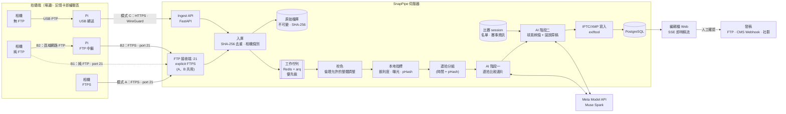
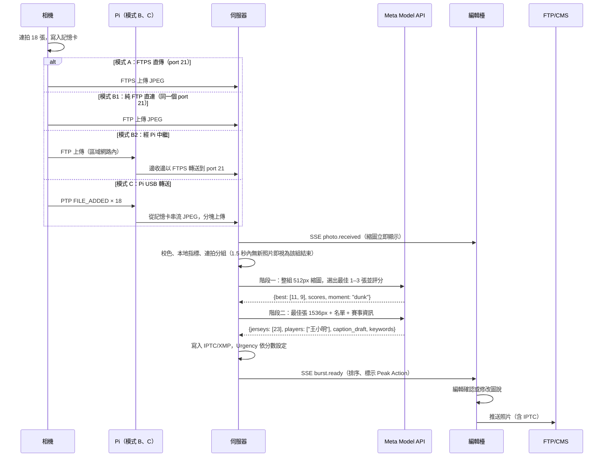
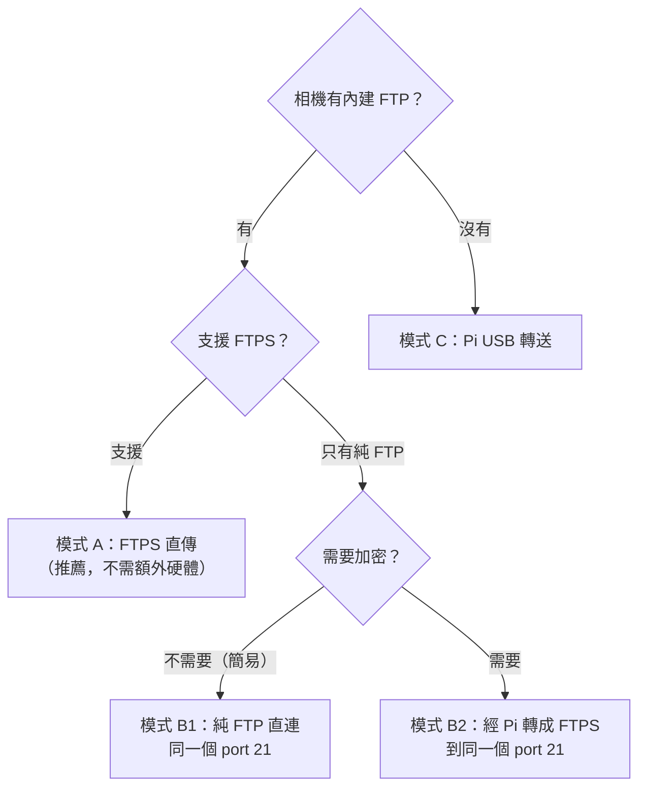
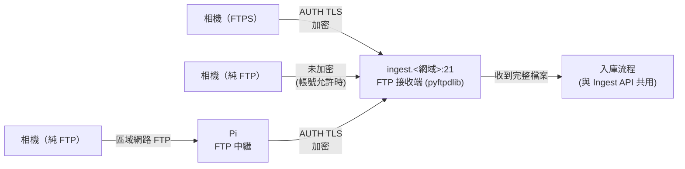
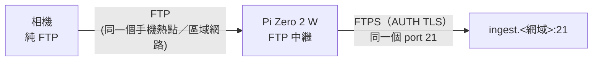
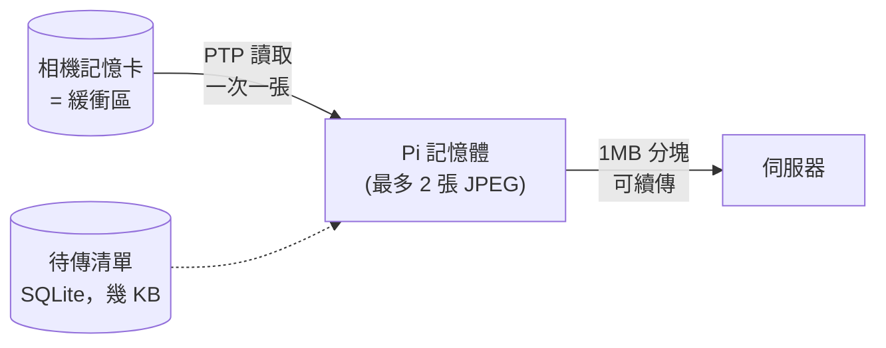

# SnapPipe 設計文件（Design Document）

> **體育新聞攝影的即時回傳系統。** 快門按下幾秒後，照片已經上傳備份、完成符合新聞倫理的校色、由 Meta AI 選出最佳瞬間、辨識球員並草擬圖說，編輯檯只要確認就能發稿。

| 項目 | 內容 |
|---|---|
| 專案名稱 | SnapPipe |
| 參加活動 | Meta Global AI Developer Hackathon 2026（線上，10/26 – 11/4） |
| 建議賽道 | Indie Developer Track（個人開發者） |
| 對應主題 | Build for Your World：開發者本身拍體育新聞，把 Meta 的模型帶進自己每天面對的截稿壓力 |
| 核心使用者 | 體育攝影記者／特約攝影（stringer）、編輯檯圖片編輯 |
| 使用的 Meta AI | Meta Model API（Muse Spark：多圖影像理解 + 結構化 JSON 輸出）、Muse Code（開發輔助） |
| 文件版本 | v0.6：支援多台相機同時使用（含同型號機身）、以機身序號識別相機、資料分類與命名規則 |

---

## 目錄

1. [摘要](#1-摘要)
2. [問題：體育新聞攝影的「速度戰」](#2-問題體育新聞攝影的速度戰)
3. [目標、成功指標與非目標](#3-目標成功指標與非目標)
4. [使用者與使用情境](#4-使用者與使用情境)
5. [系統架構總覽](#5-系統架構總覽)
6. [拍攝端：三種接入模式](#6-拍攝端三種接入模式)
7. [多相機與資料分類](#7-多相機與資料分類)
8. [伺服器端處理管線](#8-伺服器端處理管線)
9. [Meta AI 的使用方式](#9-meta-ai-的使用方式)
10. [編輯檯介面（Editor Desk）](#10-編輯檯介面editor-desk)
11. [資料模型與 IPTC/XMP Metadata](#11-資料模型與-iptcxmp-metadata)
12. [API 介面](#12-api-介面)
13. [延遲預算與非功能需求](#13-延遲預算與非功能需求)
14. [新聞倫理、安全與隱私](#14-新聞倫理安全與隱私)
15. [評估方式](#15-評估方式)
16. [成本估算](#16-成本估算)
17. [風險與對策](#17-風險與對策)
18. [10 天開發時程](#18-10-天開發時程)
19. [Demo 規劃與最終提交物](#19-demo-規劃與最終提交物)
20. [未來發展](#20-未來發展)
21. [附錄](#21-附錄)

---

## 1. 摘要

體育新聞拚的是速度。關鍵進球發生後，誰的照片先出現在新聞網站、社群和通訊社的稿單上，誰就贏了。大型通訊社在場館裡有專屬網路線、現場圖片編輯和昂貴的傳輸設備，**特約攝影、地方媒體和學生記者卻只能在比賽中場或結束後**才把記憶卡插進筆電，一邊挑片一邊打圖說，常常錯過發稿的黃金時間。

SnapPipe 直接使用**相機內建的 FTP 傳輸功能**；沒有 FTP 的相機，則加一台約 US$15 的 **Raspberry Pi Zero 2 W** 轉送。再搭配 **Meta Model API**，把通訊社等級的回傳流程帶給每一位攝影記者：

1. **即時回傳**：快門按下後，相機透過內建 FTP 把 JPEG 傳到伺服器；沒有 FTP 的相機由 Pi 經 USB 轉送。**記憶卡就是緩衝區**，網路斷了照片就留在卡上，恢復後再傳（[§6](#6-拍攝端三種接入模式)）。
2. **雙重備份**：記憶卡保留一份，伺服器再存一份不可變的原始檔；RAW 賽後從記憶卡匯入。
3. **符合倫理的校色**：只做新聞倫理允許的整體調整（曝光、白平衡、對比與媒體的色彩風格），**不改變畫面內容**。
4. **AI 挑片與理解**：Muse Spark 以**整組連拍**為單位比較，選出「決定性瞬間」（球觸手、表情最高點、主體清晰），同時評分、辨識**球衣號碼與隊伍**，並標記畫面中的關鍵動作。
5. **圖說草稿**：依照賽前載入的**比賽資訊與球員名單**，用新聞社的格式草擬圖說，並寫進 **IPTC** 欄位。
6. **編輯檯一鍵發稿**：圖片編輯在網頁上看到依分數排序的即時稿流，確認或修改圖說後，一鍵推送到 FTP、CMS 或社群。

**目標：從快門到「可發稿的照片與圖說草稿」少於 60 秒。** 傳統流程通常要等中場或賽後。

## 2. 問題：體育新聞攝影的「速度戰」

### 2.1 傳統流程與瓶頸


| 瓶頸 | 說明 | SnapPipe 的做法 |
|---|---|---|
| **傳輸要等** | 比賽進行中無法離開位置，照片卡在記憶卡裡；相機雖有 FTP，但傳到 FTP 之後仍要有人挑片、打圖說 | 相機 FTP 或 Pi 在背景自動上傳，伺服器接手後續所有處理，攝影師繼續拍 |
| **連拍挑片** | 現代無反相機每秒 20–30 張，一個進球就是幾十張幾乎一樣的照片 | AI 以整組連拍比較，選出關鍵瞬間 |
| **圖說最花時間** | 要從球衣號碼對照名單、確認比賽節次與地點、依格式撰寫 | AI 辨識號碼並比對名單，自動帶入比賽資訊，草擬出符合格式的圖說 |
| **沒有後援** | 大型媒體有現場圖片編輯，特約攝影只有自己一個人 | 遠端編輯（或攝影師自己用手機）在網頁上就能完成挑片與發稿 |
| **備份風險** | 記憶卡損壞或遺失，整場就沒了 | 拍完幾秒內異地備份 |

### 2.2 為什麼是現在、為什麼用 Meta AI

- 多模態模型已經能**同時看多張照片並互相比較**，正好對應連拍挑片的需求。過去的單張美學評分模型做不到這種「比較」。
- 結構化輸出（JSON Schema）讓 AI 的結果可以**直接寫進新聞業標準的 IPTC 欄位**，不必另外解析自然語言。
- 專業相機已經內建 FTP，沒有的也只要加一台便宜的 Pi，再加上低成本 API，讓**個人攝影師**也負擔得起原本只有通訊社才有的流程。

## 3. 目標、成功指標與非目標

### 3.1 目標與成功指標

| # | 目標 | 指標 | 目標值 |
|---|---|---|---|
| G1 | 照片即時進到編輯檯 | 快門到編輯檯出現縮圖（JPEG） | p50 < 10 秒、p95 < 20 秒 |
| G2 | 可發稿的速度 | 快門到出現 AI 選片與圖說草稿 | p50 < 60 秒 |
| G3 | 挑片品質 | AI 每組連拍選的照片和攝影師自己選的一致（Top-3 命中率） | ≥ 70% |
| G4 | 圖說正確性 | 球衣號碼辨識正確率／圖說人名正確率（有名單時） | ≥ 90% ／ ≥ 95% |
| G5 | 不遺失 | 斷網、重開機或連拍爆量時遺失的照片數 | 0 |
| G8 | 相機歸屬正確 | 多台相機（含同型號）同時拍攝時，照片被標錯相機的比例 | 0% |
| G6 | 新聞誠信 | 原始檔與編輯歷程完整保留，校色只做整體調整 | 100% 可追溯 |
| G7 | 實際省時 | 模擬截稿測試中送出 5 張可發稿照片的時間（傳統流程 vs. SnapPipe） | 縮短 ≥ 70% |

### 3.2 非目標

- **不做影像內容修改**：不去背、不移除物件、不使用生成式填補。這違反新聞倫理。
- **AI 不自動發稿**：所有對外發布都要人工確認（human-in-the-loop）。
- **不做人臉辨識**：球員身分由**球衣號碼加名單**比對，不建立生物特徵資料庫（見 [§14](#14-新聞倫理安全與隱私)）。
- 不在 Pi 上做任何影像運算或篩選（Pi 只負責轉送）；不做多租戶 SaaS 與計費。

## 4. 使用者與使用情境

### 4.1 角色

| 角色 | 需求 | 使用介面 |
|---|---|---|
| **攝影記者**（現場） | 專心拍，不想分心處理傳輸；常同時用兩台機身；偶爾用手機看 AI 選了哪些 | 一或多台相機（內建 FTP，或加 Pi）；手機版編輯檯 |
| **圖片編輯**（編輯檯／遠端） | 第一時間看到最好的照片，快速確認圖說並發稿 | 桌機版編輯檯 |
| **特約攝影**（一人包辦） | 同時當攝影師和編輯，在場邊用手機發稿 | 手機版編輯檯 |

### 4.2 情境 A：籃球比賽，關鍵灌籃

1. 賽前，攝影記者在網頁建立「比賽 session」：賽事名稱、場館、城市、日期、主客隊，並匯入兩隊名單（CSV：號碼、姓名、位置）。接著用相機拍一張手機上的**對時 QR**，校正相機時間。
2. 第三節 7:42，主隊 #23 灌籃，攝影師連拍 18 張。
3. 相機透過內建 FTP 自動上傳 JPEG（沒有 FTP 的機身由 Pi 轉送）；伺服器收到後才計算銳利度與分組。
4. 伺服器校色後，把這組連拍送給 Muse Spark 比較，選出球進籃框瞬間、臉部清晰的第 11 張。模型讀出球衣號碼 23 與主隊配色，比對名單得到「王小明」。
5. 系統草擬圖說：
   > 台北，2026 年 10 月 30 日 — 台北雄鷹隊王小明（#23）於第三節灌籃得分。此為台北雄鷹隊與新竹獵豹隊之戰，地點為台北體育館。（攝影：李攝影／SnapPipe）
6. 圖片編輯的畫面上，這組連拍以「🔥 Peak Action, 9.1 分」排在最前面。編輯確認人名、按下 `Enter`，照片連同 IPTC 一起推送到報社 FTP。**從快門到發稿約 45 秒。**

### 4.3 情境 B：特約攝影一人作業

棒球場邊沒有編輯支援。攝影師在攻守交換的空檔打開手機，「本局精選」已經排好 5 張，圖說也有草稿。滑動確認後一次送出，接著繼續拍下一局。

### 4.4 情境 C：多機位報導

報社派兩位攝影師加一台籃板後的遙控相機，共 4 台相機，其中兩台是同型號。每台相機的照片都依機身序號正確歸類並標上機位，同一記灌籃的「籃板後」與「底線」兩個角度會出現在同一張多角度卡片上，編輯挑一張最好的發稿，圖說署名自動帶入實際拍攝的攝影師（[§7](#7-多相機與資料分類)）。

### 4.5 情境 D：賽後交付

比賽結束時，全部照片都已備份並寫好 IPTC。編輯可以一鍵匯出「本場精選 30 張」交給客戶或通訊社，照片也能在 Photo Mechanic、Lightroom 中依關鍵字和星等搜尋。

## 5. 系統架構總覽



### 5.1 單一關鍵瞬間的時序



## 6. 拍攝端：三種接入模式

許多專業機身（例如 Sony、Canon、Nikon 的旗艦與中高階機種）**本身就有 FTP 傳輸功能**，可以透過 Wi-Fi 或有線網路，拍完自動把照片傳到 FTP 伺服器，這也是通訊社攝影記者常用的回傳方式。SnapPipe 因此**不強制使用 Pi**，而是依相機能力提供三種接入方式，伺服器端的處理流程完全相同。

### 6.0 模式總覽與選擇

模式 A 和 B 共用伺服器上**同一個 FTP 接收端**（同一個主機名稱、同一個 port 21），相機的設定方式完全一樣，差別只在連線有沒有加密（[§6.2](#62-ftp-接收端模式-ab-共用同一個-port)）。

| | **模式 A：FTPS 直傳** | **模式 B：純 FTP** | **模式 C：Pi USB 轉送** |
|---|---|---|---|
| 適用相機 | 內建 FTP，支援 **FTPS** | 內建 FTP，只支援**純 FTP** | 沒有 FTP 功能 |
| 伺服器入口 | `ingest.<網域>:21`（FTPS） | `ingest.<網域>:21`（同一個 port） | Ingest API（HTTPS） |
| 額外硬體 | 不需要 | B1 直連：不需要；B2 加密：Pi | Pi Zero 2 W + USB 線 |
| 加密 | TLS | B1：無（以帳號限制降低風險）；B2：Pi 對外改用 FTPS | WireGuard／HTTPS |
| 連拍中傳輸 | 相機原生支援，不影響拍攝 | 相機原生支援，不影響拍攝 | 需實測 PTP 讀卡是否影響連拍 |
| 斷線處理 | 相機保留未傳清單，恢復後重送 | 同 A（B2 時 Pi 拒收，由相機重送） | Pi 待傳清單，最新的先傳 |
| 相機耗電 | 較高（相機無線模組持續運作） | 較高 | 較低（USB 傳輸） |
| 設定難度 | 在相機選單設定一次 | 同 A；B2 只要把主機改成 Pi 的 IP | 接線即可 |



**建議**：有 FTPS 的機身優先用模式 A，設定最少、速度最快（相機可用 5GHz Wi-Fi 或有線網路），也不必擔心讀卡影響連拍。

### 6.1 共同原則

不論哪一種模式，都遵守以下原則：

- **記憶卡是唯一的緩衝區**：照片一定先寫進記憶卡。網路斷了，照片就留在卡上；Pi 和伺服器的 FTP 端都不負責暫存未送達的照片。
- **只即時傳 JPEG**：相機設定只傳 JPEG（M 或 S 尺寸，約 2–5MB），RAW 留在記憶卡上，賽後再匯入（[§6.5](#65-賽後匯入與補傳所有模式共用)）。
- **以內容去重**：伺服器以 SHA-256 判斷是否重複，不依賴檔名（相機的檔案編號會歸零或重複）。同一張照片從 FTP、Pi 和賽後匯入各傳一次，也只會入庫一次。
- **相機識別與 session 綁定**：每張照片以**機身序號**判斷是哪一台相機拍的（FTP 帳號或 Pi 只當輔助），再依「相機 + 拍攝時間」歸入當時進行中的比賽 session（[§7](#7-多相機與資料分類)）。
- **時間校正**：比對比賽節次需要準確的拍攝時間，但相機時鐘常常不準。三種模式都支援以下方式：
  1. **對時 QR（推薦）**：賽前在手機上打開編輯檯的「對時」頁面，畫面顯示每 0.5 秒更新一次的時間 QR code。攝影師拍一張，伺服器解出 QR 內的時間，和照片 EXIF 時間相減，就得到這台相機精確的 `clock_offset`。
  2. 模式 C 由 Pi 直接讀取相機時鐘計算。
  3. 都沒有時，伺服器以「收到時間 − EXIF 拍攝時間」在本場的最小值估算（誤差約為最短傳輸時間，數秒內）。

### 6.2 FTP 接收端：模式 A、B 共用同一個 port



**為什麼可以共用同一個 port**：伺服器使用 **explicit FTPS（FTPES）**。連線一開始都是一般的 FTP，支援加密的相機會先送 `AUTH TLS` 指令升級成加密連線，只支援純 FTP 的相機則直接登入。因此 FTPS 和純 FTP 可以用**同一個 port 21**，由伺服器依帳號決定是否接受未加密的登入。

**連接埠規劃**

| 用途 | 連接埠 | 說明 |
|---|---|---|
| 控制連線 | 21 | A、B 共用 |
| 資料連線（被動模式） | 固定一段範圍，例如 50000–50100 | FTP 協定本身需要另開資料連線，A、B 共用同一段範圍；防火牆只開這兩組 |
| SFTP（選配） | 22 | SFTP 是另一種協定，無法和 FTP 共用 port。只有「支援 SFTP、但不支援 FTPS」的機身才需要開；兩者都支援時一律用 FTPS |

**伺服器端實作**

- 使用 **pyftpdlib**（Python，與伺服器同一套技術）的 `TLS_FTPHandler`。
- **每台相機一組帳號**，帳號對應到 `device_id`，並設定加密政策 `tls_policy`：
  - `required`（預設）：沒有先完成 `AUTH TLS` 就拒絕登入。模式 A 與 B2 使用。
  - `allow_plain`：允許未加密登入。只給模式 B1 的帳號使用。
- 所有帳號都只有**上傳**權限，不能列目錄、下載或刪除；每個帳號有獨立目錄與容量上限；帳號可以隨時停用（例如相機遺失）。
- 收檔時一律寫成**唯一的暫存檔名**，不使用相機送來的檔名，避免同型號相機的同名檔案互相覆蓋（原始檔名另存為 metadata）。
- 檔案**完整收完**（`on_file_received`）才交給入庫流程：檢查 JPEG 結構是否完整、計算 SHA-256、存入原始檔庫、送進工作佇列，之後和模式 C 完全相同。
- 傳到一半中斷的檔案（`on_incomplete_file_received`）直接刪除，等相機重送。

**相機端建議設定**（A、B 相同）

| 設定項目 | 建議值 | 說明 |
|---|---|---|
| 伺服器 | `ingest.<網域>`，port 21（B2 改填 Pi 的區域網路 IP） | A、B 共用 |
| 安全連線 | 有 FTPS 就開啟（explicit） | 沒有的機身用 B1 或 B2 |
| 被動模式 | 開啟 | 穿過場館或手機熱點的 NAT |
| 自動 FTP 傳輸 | 開啟 | 拍完自動傳送 |
| 傳送檔案類型 | 只傳 JPEG | RAW 留在記憶卡 |
| JPEG 尺寸 | M 或 S | 網路差時改 S |
| 傳送範圍 | 全部，或「只傳保護／評分過的照片」 | 見下方兩種工作方式 |
| 網路 | 場館有線網路 > 5GHz Wi-Fi > 手機熱點 | 有些旗艦機身有網路孔，可接場館有線網路 |

**兩種工作方式**

- **全部傳送**（預設）：每張照片都即時傳，由 AI 負責挑片和圖說，適合一人作業的特約攝影。
- **攝影師先挑**：相機設定成只傳攝影師在機身上按過保護或評分的照片。照片已經經過人工篩選，AI 的重點就放在**球員辨識與圖說**；連拍比較依然可用來推薦同組裡更好的一張。

**斷線時**：相機的 FTP 功能會記錄每張照片的傳送狀態，網路恢復後重送未完成的照片（自動重送的行為依機身而定，D1 實測）。如果相機沒有重送，攝影師可以在機身選單手動補傳，或賽後匯入。

### 6.3 模式 B：純 FTP 的兩種接法

純 FTP 會以明文傳送帳號密碼和照片。SnapPipe 提供兩種接法，**都連到同一個 port 21**，可以依現場需求切換：

**B1：直連（簡易，不需 Pi）**

相機直接連到 `ingest.<網域>:21`，帳號設為 `allow_plain`。為了降低明文傳輸的風險：

- 帳號**只能上傳**，就算密碼外流，也無法讀取、下載或刪除任何照片。
- **每場比賽產生一組臨時密碼**，賽後自動失效；密碼外流的影響只限這一場。
- 可以限制來源 IP（例如只允許場館網路的出口 IP），登入失敗多次自動封鎖。
- 照片內容仍是明文傳輸。**未發布的敏感照片**（例如涉及傷病或尚未公開的人物）應改用 B2。

**B2：經 Pi 轉成 FTPS（加密）**



- 相機和 Pi 連到**同一個手機熱點或場館 Wi-Fi**，相機的 FTP 主機改填 Pi 的區域網路 IP，其他設定和 B1 完全相同。明文 FTP 只在區域網路內傳輸。
- Pi 上跑同一套 pyftpdlib 程式，收到上傳後**邊收邊轉送**：同時以 FTPS 開一條連線到伺服器的 port 21，資料直接串流過去，不寫入 Pi 的儲存空間，符合「Pi 只負責轉送」的原則。
- Pi 使用該相機的帳號登入伺服器，伺服器看到的就是同一台相機，`tls_policy` 可以維持 `required`。
- **伺服器連不上時，Pi 直接回 FTP 錯誤（`451`）拒收**。相機會把這張標記為傳送失敗，稍後重送，照片仍安全地留在記憶卡上，Pi 不需要暫存。
- Pi 的記憶體同時最多處理 2 個檔案；相機同時開多條 FTP 連線時，其餘的請相機稍候重試。

### 6.4 模式 C：Pi USB 轉送

給**沒有 FTP 功能**的相機使用。Pi Zero 2 W 只有 512MB RAM，microSD 的寫入速度和壽命都有限；拍攝現場的網路也常常很差，甚至會完全斷線。因此 **Pi 只做一件事：把相機上的 JPEG 轉送到伺服器**。

- **不做影像運算**：不解碼、不算銳利度、不篩選。所有影像分析都在伺服器上做。
- **不暫存照片**：Pi 只記錄「還有哪些檔案沒傳」，這份清單只有幾 KB。
- **網路恢復就繼續傳**：沒有任何東西需要重新處理。

#### 6.4.1 硬體

| 項目 | 規格／說明 |
|---|---|
| 主機 | Raspberry Pi Zero 2 W：四核 Cortex-A53、512MB RAM、2.4GHz Wi-Fi |
| 相機連線 | micro-USB OTG 轉 USB-C／USB-A，連到相機 USB 埠 |
| 網路 | 場館 Wi-Fi，或手機熱點（5G）；選配 USB 網卡（需要 OTG Hub） |
| 儲存 | 8GB microSD，只放系統和待傳清單，**不存照片**，可以設定成唯讀 rootfs，降低突然斷電損壞的機率 |
| 電源 | 行動電源，Pi Zero 2 W 一般約 1W 上下，10,000mAh 足以撐完整場比賽（實測確認） |
| 狀態顯示 | 選配 LED 或 0.96" OLED：顯示待傳張數與連線狀態，攝影師一眼就知道網路是否正常 |
| 安裝方式 | 3D 列印外殼，以冷靴座或束帶固定在相機或背帶上 |

#### 6.4.2 擷取：libgphoto2 連線拍攝

- 透過 `python-gphoto2` 監聽 `GP_EVENT_FILE_ADDED`。快門觸發後取得新檔在記憶卡上的路徑，**只把路徑、大小、時間寫進待傳清單**，不下載到 Pi 的儲存空間。
- 相機設定 `capturetarget = Memory card`：照片永遠先寫進記憶卡，Pi 斷電、當機都不會影響相機拍攝。
- **建議拍攝設定**：RAW + JPEG。JPEG 用 M 或 S 尺寸（約 2–5MB），讓差的網路也傳得動。
- **時間同步**：Pi 透過網路 NTP 校時，並讀取相機時間計算 `clock_offset`，隨上傳帶給伺服器（其他模式的做法見 [§6.1](#61-共同原則)）。
- **備援**：相機不支援 PTP 事件時，改為定時列出記憶卡檔案並比對清單。

#### 6.4.3 上傳：從記憶卡直接串流到伺服器



1. 從待傳清單取出下一張，用 PTP 從記憶卡讀進記憶體（JPEG 只有幾 MB，同時最多處理 2 張，記憶體上限約 20MB）。
2. 以 **1MB 分塊**上傳到伺服器。網路差的時候，每個成功的分塊都不會白傳。
3. 伺服器收齊並回應成功後，從清單標記完成。Pi 上不留任何檔案。

**上傳順序：最新的先傳。** 網路恢復時，如果累積了大量待傳照片，Pi 會先傳**最新拍的照片**，再回頭補舊的。對新聞來說，剛剛發生的事比十分鐘前的更重要；舊照片之後仍會全部補上。這只是調整清單的讀取順序，Pi 不需要做任何影像運算。

#### 6.4.4 網路差或斷線時

| 狀況 | Pi 的行為 |
|---|---|
| 網路慢 | 分塊上傳持續進行；OLED／LED 顯示待傳張數，攝影師可以自行決定是否改拍 S 尺寸 JPEG |
| 網路短暫中斷 | 指數退避重試；回來後從伺服器確認的最後一個分塊繼續 |
| 長時間斷線 | 照片照常寫進記憶卡，清單持續累積；恢復後最新的先傳 |
| Pi 重開機或斷電 | 清單存在 SQLite（WAL 模式），開機後自動接續；相機和記憶卡完全不受影響 |
| 整場都沒網路 | 賽後用記憶卡匯入（[§6.5](#65-賽後匯入與補傳所有模式共用)），伺服器一樣會做 AI 處理 |

**冪等與續傳**

- 每張照片用 `upload_id = hash(機身序號, 記憶卡路徑, 檔案大小, 拍攝時間)` 當作上傳識別碼（Pi 開機與接上相機時以 gphoto2 讀取機身序號），以 `PUT /v1/uploads/{upload_id}` 分塊上傳，`HEAD` 查詢已收到的 byte 數，重傳完全冪等。
- **SHA-256 由伺服器計算**，作為原始檔庫的內容定址鍵。Pi 不需要先把整個檔案讀完算雜湊值。
- 以 systemd 服務常駐，開機自動啟動，並有 watchdog。
- 透過 **WireGuard／Tailscale** 連回伺服器，不需要對外開放 port，也能穿過場館網路的 NAT。

### 6.5 賽後匯入與補傳（所有模式共用）

- 提供 `snappipe import <記憶卡路徑>` 指令（在筆電或伺服器上執行），把記憶卡上的 JPEG 和 RAW 匯入伺服器。
- 伺服器以 SHA-256 去重：**現場已經傳過的 JPEG（不論經相機 FTP 或 Pi）會自動略過**，只補上沒傳到的照片和 RAW。
- RAW 匯入後會寫 `.xmp` sidecar，帶入現場已經完成的評分、圖說與標籤。

## 7. 多相機與資料分類

體育新聞現場通常不只一台相機：一位攝影師常同時背兩台機身（長焦、廣角），還有籃板後、球門後的**遙控相機**，而且**同型號的機身很常見**。SnapPipe 因此把「每張照片是哪一台相機拍的」當作核心資料，從入庫開始就正確分類。

### 7.1 典型配置（範例）

| 相機代號 | 機身 | 使用者 | 機位 | 接入方式 |
|---|---|---|---|---|
| CAM-A | 型號 X（序號 …4821） | 攝影師甲 | 主隊側底線，長焦 | 模式 A（FTPS） |
| CAM-B | 型號 X（序號 …5530）**與 CAM-A 同型號** | 攝影師甲 | 主隊側底線，廣角 | 模式 A（FTPS） |
| CAM-C | 型號 Y（序號 …0917） | 無人操作（遙控） | 籃板後 | 模式 C（Pi USB） |
| CAM-D | 型號 Z（序號 …3302） | 攝影師乙 | 客隊側中線 | 模式 B1（純 FTP） |

### 7.2 名詞：相機、接入通道、攝影師、機位

| 名詞 | 定義 | 識別方式 |
|---|---|---|
| **相機（camera）** | 實體機身 | **廠牌 + 型號 + 機身序號**，全系統唯一 |
| **接入通道（channel）** | 照片「怎麼進來」：某個 FTP 帳號或某台 Pi | 帳號或裝置 token |
| **攝影師（photographer）** | 在某場比賽被指派使用某台相機的人；圖說署名依此帶入 | session 指派（可設定時段，支援中途換人） |
| **機位（position）** | 這場比賽中該相機的位置或用途 | session 指派 |

**接入通道不等於相機**：FTP 帳號可能被誤設在兩台機身上，Pi 也可能被換接到另一台相機。所以「誰拍的」以機身本身的資訊為準，通道只當作輔助與交叉檢查。

### 7.3 相機識別：以機身序號為準

每張照片入庫時，依下列順序決定 `camera_id`，並記錄依據（`camera_match`）：

| 順序 | 依據 | 來源 | 說明 |
|---|---|---|---|
| 1 | **EXIF 機身序號** | `BodySerialNumber`（EXIF 0xA431）或廠商 MakerNotes 內的序號 | 多數機身會寫進 JPEG；**同型號機身也能區分**（D1 實測你的機身） |
| 2 | **PTP 讀取的序號** | 模式 C 由 Pi 透過 gphoto2 讀取相機序號，隨上傳一起送出 | 不依賴 JPEG 內容 |
| 3 | **機身自訂標記** | EXIF `Artist`／`Copyright`，或自訂檔名前綴 | 賽前在每台機身設定，例如 Artist=`SNAP-CAM-B`、檔名前綴 `B__` |
| 4 | **接入通道** | FTP 帳號或 Pi 綁定的預設相機 | 最後手段，會標記為「低信心」 |

- **衝突偵測**：通道預期的相機和序號判斷的不同時，**以序號為準**，並標記 `identity_conflict`。編輯檯會跳出提示，例如「FTP 帳號 `cam-a` 收到 CAM-B 的照片，可能兩台相機設成同一組帳號」。
- **未知相機**：出現沒看過的序號時，自動建立一筆「待命名相機」，照片照常入庫與處理，編輯檯提示命名並指派攝影師。**任何照片都不會因為認不出相機而被丟掉。**
- **完全無法識別**（沒有序號、沒有標記，而且通道被多台共用）：歸到「未識別（通道 X）」，並在編輯檯標紅，人工指定後可批次修正。

**賽前檢查清單**（編輯檯「相機設定」頁面會逐台檢查）：

1. 拍一張對時 QR → 確認系統讀得到序號、時間誤差已校正。
2. 機身設定 `Artist` 或檔名前綴（序號讀不到時的備援）。
3. 每台機身使用自己的 FTP 帳號。

### 7.4 同型號相機的處理細節

| 問題 | 做法 |
|---|---|
| **檔名重複**（兩台都會產生 `DSC01234.JPG`） | 原始檔以 SHA-256 內容定址儲存；FTP 接收端收檔時一律改用唯一的暫存名稱，原始檔名只當作 metadata 保存，**不會互相覆蓋**；模式 C 的 `upload_id` 包含機身序號 |
| **連拍分組誤合併**（兩台同時拍同一瞬間，畫面相似） | 連拍分組的鍵包含 `camera_id`，**不同相機的照片絕不會被分進同一組連拍** |
| **時鐘各自漂移** | 時間誤差 `clock_offset` 以**機身**為單位，每台相機各拍一次對時 QR |
| **介面上分不清** | 顯示「代號 + 序號末四碼」，例如 `CAM-B（…5530）`，每台相機有固定的顏色標籤 |

### 7.5 多台相機同時上傳

- **連線數限制**：每個 FTP 帳號同時最多 2 條連線，另設全域上限，避免某一台相機占滿頻寬或伺服器資源。
- **公平排程**：工作佇列以**相機為單位輪流處理**（round-robin），同一台相機內則新照片優先。遙控相機一次連拍 40 張，也不會讓攝影師乙剛拍到的關鍵畫面排到後面。AI 呼叫的並行額度也依相機公平分配。
- **共用網路時**：多台相機共用一個手機熱點，建議副機（例如廣角或遙控相機）只傳 S 尺寸 JPEG。
- **相機狀態面板**：編輯檯顯示每台相機的連線狀態、最後一張收到的時間、今日張數；超過設定時間沒有新照片會提示（可能沒電或斷線）。
- **容量目標**：4 台相機同時連拍（各 10 張／秒、持續 3 秒）不掉檔、不誤判相機。

### 7.6 跨相機的「同一瞬間」

- 各相機時間校正後，不同相機在 **±1 秒內**重疊的連拍組會歸成一個**瞬間群組（moment group）**。
- 編輯檯以「多角度」卡片呈現，例如同一記灌籃的「籃板後遙控」與「底線長焦」兩個角度，編輯可以直接挑最好的角度發稿。
- 各組的 AI 分數在同一套準則下產生，可以直接比較；跨角度由 AI 再比較一次（只送每台相機的最佳張）列為 P2。
- 同一瞬間中，某個角度看得到的球衣號碼可以提供給其他角度當參考，但只作為提示並標記 `needs_review`，不直接當作辨識結果。

### 7.7 資料分類與命名

**分類維度**：所有照片都可以依以下維度篩選、排序與匯出：

比賽（session）→ 相機 → 攝影師 → 機位 → 球員 → 瞬間類型（`moment`）→ 挑選狀態（選用／淘汰／已發稿）

**排序**：體育連拍每秒 20–30 張，只到「秒」不夠。同一台相機內以 `DateTimeOriginal` + `SubSecTimeOriginal`（毫秒）排序，再以相機的檔案編號作為最後依據；跨相機則使用校正後的時間。

**匯出的資料夾結構與檔名**（預設，可以改成依攝影師或球員分）：

```
2026-10-30_台北雄鷹vs新竹獵豹/
├── CAM-A_甲_底線長焦_4821/
│   ├── 20261030-204107.123_CAM-A_DSC01234.jpg
│   └── 20261030-204107.156_CAM-A_DSC01235.jpg
├── CAM-B_甲_底線廣角_5530/
│   └── 20261030-204107.140_CAM-B_DSC01234.jpg   ← 原始檔名和 CAM-A 相同，也不會衝突
├── CAM-C_遙控_籃板後_0917/
├── CAM-D_乙_客隊中線_3302/
└── _精選/
    └── 20261030-204107.140_CAM-B_DSC01234.jpg
```

檔名格式為 `{校正後時間，到毫秒}_{相機代號}_{原始檔名}`：多台相機的檔案混在一起也會依時間正確排序，而且不會撞名。

**寫入照片的相機資訊**：保留原始 EXIF 的 `Make`、`Model`、`BodySerialNumber`，另外寫入 `XMP-snappipe:CameraId`、`CameraName`、`CameraPosition`；`Creator` 依該相機在本場指派的攝影師帶入，**多位攝影師的署名不會混淆**（見 [§11.2](#112-寫入照片的-metadataiptc-photo-metadata-standard)）。

## 8. 伺服器端處理管線

### 8.1 技術選型

| 子元件 | 技術 | 說明 |
|---|---|---|
| Ingest API | Python 3.12 + FastAPI | 接收 Pi 的分塊上傳與賽後匯入，驗證裝置 token |
| FTP 接收端 | pyftpdlib（explicit FTPS，port 21）；選配 SFTP（port 22） | 模式 A、B 共用；每台相機獨立帳號、只能上傳、依帳號決定是否必須加密；收完整檔才入庫 |
| 入庫流程 | 共用模組 | 所有接入方式最後都走這裡：檢查檔案、計算 SHA-256 去重、存檔、送進佇列 |
| 原始檔庫 | 本機磁碟或 MinIO（S3 相容） | 路徑為 `originals/{sha[0:2]}/{sha}.{ext}`，只寫一次 |
| 工作佇列 | Redis + arq | 每個步驟是獨立 job，支援**優先級**、重試與單步重跑 |
| 影像處理 | libvips（pyvips）、rawpy | 速度快、記憶體用量低，全尺寸 JPEG 處理在數百毫秒內完成 |
| 本地指標 | OpenCV、imagehash | 銳利度、直方圖剪裁比例、pHash |
| Metadata | exiftool（常駐 `-stay_open` 模式） | 避免每張照片重新啟動 exiftool 的開銷 |
| 資料庫 | PostgreSQL 16 | 照片、連拍組、分數、球員、圖說與發稿紀錄 |
| 即時推播 | Server-Sent Events | 推送事件給編輯檯 |
| 發稿 | FTP/SFTP client、HTTP webhook | 對接報社 FTP、CMS 或通訊軟體 |

### 8.2 校色：「倫理允許的」整體調整

新聞攝影的倫理規範（例如 NPPA 的 Code of Ethics）允許**整體性的**曝光、對比、白平衡與色彩調整，**不允許**增減或改變畫面內容。SnapPipe 的「濾鏡」因此設計為**媒體色彩風格（House Style）**：

- **允許**：3D LUT（`.cube`，例如報社統一的色調）、曝光與白平衡補償、對比、輕度銳化，以及依場館燈光預設的校正（例如某體育館的色溫偏差）。
- **不允許，也不提供**：局部塗抹、物件移除、生成式填補、改變畫面內容的濾鏡。
- 每張照片記錄 `preset_id` 與 `preset_version`，原始檔永遠保留，可以隨時重新產生或比對。
- 裁切交給編輯在編輯檯上手動完成。AI 可以**建議**裁切框（例如社群用的 4:5），但只是建議，必須由編輯套用。

### 8.3 連拍分組

- **只在同一台相機內分組**（分組鍵包含 `camera_id`）：拍攝間隔小於 0.5 秒（體育連拍）或 pHash 漢明距離小於門檻，就歸為同一組。不同相機的同一瞬間另外歸成瞬間群組（[§7.6](#76-跨相機的同一瞬間)）。
- 某組超過 **1.5 秒沒有新照片**就視為結束，立即送進 AI 階段一。
- 若一組超過 40 張（長時間連拍），每 40 張切成一個子組先處理，降低延遲。

### 8.4 優先級與降級

- **熱路徑**（快門到編輯檯）只包含：接收 → 縮圖 → SSE 推送，完全不等 AI。
- AI 是**非同步增強**：AI 結果回來後再更新排序和圖說。API 變慢或失敗時，編輯檯仍然能用時間排序加本地銳利度排序繼續工作。
- 比賽進行中，新照片優先於舊照片：重跑和 RAW 處理的優先級最低。

## 9. Meta AI 的使用方式

### 9.1 模型與方案

- **Meta Model API：Muse Spark**。多模態，支援多張影像輸入與 JSON 輸出，context 很長，可以一次放進整組連拍、名單和格式範例。
- 使用 **standard tier**，**不使用 contributor tier**，避免新聞照片（含未發布素材與可識別人物）被用於模型訓練。
- 開發過程使用 **Muse Code** 輔助撰寫程式。

### 9.2 兩階段設計

把「挑片」和「理解與撰寫」拆開，在**速度、成本和品質**之間取得平衡：

| | 階段一：連拍比較選片 | 階段二：球員辨識與圖說 |
|---|---|---|
| 輸入 | 整組連拍（最多 40 張）的 512px 縮圖，加上本地銳利度 | 選出的最佳 1–3 張，1536px；比賽 session（名單、賽事、場館）；EXIF 時間與 `clock_offset` |
| 任務 | 比較同組照片，選出決定性瞬間、評分、判斷動作類型 | 讀取球衣號碼與隊伍配色、比對名單、描述動作、依格式草擬圖說與關鍵字 |
| 輸出 | 最佳張索引、各張分數、`moment` 類型、問題標記 | 球員清單（含信心值）、圖說草稿、標題、關鍵字、建議裁切 |
| 送出頻率 | 每組一次 | 只處理最佳張（約佔總張數 5–10%） |

### 9.3 階段一：選片準則（Prompt 摘要）

```
System: 你是資深體育通訊社圖片編輯。以下是同一組連拍的 N 張照片
        （依時間排序，編號 0..N-1）。請選出最有新聞價值的 1–3 張。

選片準則（依重要性）：
1. 決定性瞬間：球與手、腳、球拍接觸的瞬間；動作最高點；
   慶祝、懊惱等情緒最飽滿時
2. 主體對焦：主要球員的臉或眼睛清晰；動態模糊不可遮蔽主體
3. 敘事性：球、主要球員與對手關係同框；觀眾、教練的反應
4. 構圖：主體不被裁切，沒有干擾物擋住臉
運動項目：{sport}；本地銳利度：{sharpness[]}
只輸出符合 JSON Schema 的內容。
```

```json
{
  "type": "object",
  "required": ["best", "frames", "moment"],
  "properties": {
    "best":   {"type": "array", "items": {"type": "integer"}, "minItems": 1, "maxItems": 3},
    "moment": {"enum": ["peak_action", "goal_score", "celebration", "dejection", "contested_ball",
                        "foul_injury", "coach_bench", "crowd", "portrait", "other"]},
    "frames": {
      "type": "array",
      "items": {
        "type": "object",
        "required": ["index", "overall", "peak", "focus", "composition", "issues"],
        "properties": {
          "index":       {"type": "integer"},
          "overall":     {"type": "number", "minimum": 1, "maximum": 10},
          "peak":        {"type": "number", "minimum": 1, "maximum": 10},
          "focus":       {"type": "number", "minimum": 1, "maximum": 10},
          "composition": {"type": "number", "minimum": 1, "maximum": 10},
          "issues": {"type": "array", "items": {"enum": ["out_of_focus", "motion_blur_subject",
                     "face_blocked", "subject_cropped", "ball_missing", "eyes_closed",
                     "over_exposed", "under_exposed"]}}
        }
      }
    }
  }
}
```

### 9.4 階段二：球員辨識與圖說（Prompt 摘要）

```
System: 你是體育新聞圖說編輯。請依照片內容與提供的比賽資料撰寫圖說。
        嚴格規則：
        - 球員姓名只能來自提供的名單，並且要看得到球衣號碼才能指認
        - 看不清號碼時，不要猜測姓名，jersey 填 null，並設定 needs_review
        - 不描述照片中看不到的事實（例如比分、結果），除非比賽資料有提供
        - 依指定格式（style_guide）撰寫，語言：{lang}
比賽資料：{event, venue, city, date, home, away, rosters[]}
拍攝時間（已校正）：{captured_at}
格式範例：{style_examples}
```

```json
{
  "type": "object",
  "required": ["players", "action", "headline", "caption_draft", "keywords", "needs_review"],
  "properties": {
    "players": {
      "type": "array",
      "items": {
        "type": "object",
        "required": ["team", "jersey", "name", "confidence", "role_in_frame"],
        "properties": {
          "team":          {"enum": ["home", "away", "unknown"]},
          "jersey":        {"type": ["integer", "null"]},
          "name":          {"type": ["string", "null"]},
          "confidence":    {"type": "number", "minimum": 0, "maximum": 1},
          "role_in_frame": {"enum": ["primary", "secondary", "background"]}
        }
      }
    },
    "action":        {"type": "string", "maxLength": 80},
    "headline":      {"type": "string", "maxLength": 60},
    "caption_draft": {"type": "string", "maxLength": 400},
    "keywords":      {"type": "array", "items": {"type": "string"}, "maxItems": 20},
    "crop_suggestions": {
      "type": "array",
      "items": {"type": "object", "properties": {
        "aspect": {"enum": ["16:9", "4:5", "1:1"]},
        "box":    {"type": "array", "items": {"type": "number"}, "minItems": 4, "maxItems": 4}
      }}
    },
    "needs_review": {"type": "boolean"},
    "review_reasons": {"type": "array", "items": {"type": "string"}}
  }
}
```

### 9.5 後處理與防呆

- **名單驗證**：AI 回傳的 `(team, jersey)` 必須存在於名單中，姓名一律**以名單為準覆寫**，杜絕 AI 編造人名。對不上時清空姓名，並標記 `needs_review`。
- **信心門檻**：`confidence < 0.8` 的球員在編輯檯以黃色標示，人名欄位需要人工確認。
- **圖說組裝**：日期、地點、賽事與攝影師署名等**固定欄位由系統用範本填入**，不交給 AI 生成。AI 只負責「誰在做什麼」這一段，降低出錯的範圍。
- **Schema 驗證**：解析失敗最多重試 2 次。仍然失敗就標記 `ai_failed`，編輯檯照常顯示，改用人工圖說。

### 9.6 分數融合與排序

```
burst_score = max(frame.final for frame in burst.best)
frame.final = 0.65 × overall_ai + 0.25 × peak_ai + 0.10 × norm(sharpness_local)
            − penalty(issues)                       # 例：out_of_focus −2.5、face_blocked −1.5
feed_rank   = burst_score + recency_boost(t)        # 比賽進行中，新的關鍵瞬間優先
```

權重存放在設定檔中，並依 [§15](#15-評估方式) 的評估結果調整。分數會映射成 IPTC Urgency：9 分以上為 1（最急），7–9 分為 3，其餘為 5。

## 10. 編輯檯介面（Editor Desk）

### 10.1 技術

React + Vite、SSE 即時更新、響應式設計（桌機給圖片編輯用，手機給場邊攝影師用）。

### 10.2 畫面

| 畫面 | 功能 |
|---|---|
| **賽前設定** | 建立比賽 session：賽事、場館、日期、主客隊、隊伍主色；匯入名單 CSV；選擇圖說格式範本與色彩風格 |
| **Live 稿流** | 以連拍組為單位的卡片，顯示最佳張、`moment` 標籤（🔥 Peak Action、🎉 Celebration）、分數、已校正的拍攝時間，以及**相機顏色標籤與代號**（例如 `CAM-B（…5530）· 甲 · 底線廣角`）；依 `feed_rank` 排序，新的關鍵瞬間會滑入頂部；同一瞬間的多台相機合併成「多角度」卡片；可依相機、攝影師、機位篩選 |
| **相機狀態面板** | 每台相機的連線狀態、最後收到照片的時間、張數、相機識別依據；待命名相機與 `identity_conflict` 會在這裡提示處理 |
| **連拍展開** | 展開整組照片，AI 選的照片有標記，編輯可以改選其他張 |
| **圖說編輯** | AI 草稿可以直接編輯，人名欄位有名單自動完成，低信心欄位以黃色標示；編輯完成後才能發稿 |
| **發稿** | 選擇目的地（報社 FTP、CMS webhook 或下載），選擇裁切比例後一鍵送出；記錄發稿時間與版本 |
| **賽後總覽** | 全場精選、依相機／攝影師／球員／關鍵字篩選、依 [§7.7](#77-資料分類與命名) 的資料夾結構批次匯出，以及本場的時間統計（平均快門到發稿秒數，可分相機） |

### 10.3 鍵盤操作（給圖片編輯）

| 鍵 | 動作 |
|---|---|
| `J` / `K` | 下一組 ／ 上一組 |
| `←` / `→` | 在同組連拍中切換照片 |
| `P` / `X` | 選用 ／ 淘汰 |
| `E` | 編輯圖說 |
| `C` | 套用 AI 建議的裁切 |
| `Enter` | 確認並發稿 |

### 10.4 回饋紀錄

編輯的每一次「改選其他張」「修改圖說」「淘汰」都會記錄下來，作為評估資料（[§15](#15-評估方式)），日後也能做為 few-shot 範例，讓 AI 更貼近該媒體的選片口味。

## 11. 資料模型與 IPTC/XMP Metadata

### 11.1 資料庫（簡化）

```
sessions(id, sport, event_name, venue, city, country, date,
         home_team, away_team, home_color, away_color, style_guide_id, preset_id)
roster(session_id FK, team ENUM('home','away'), jersey SMALLINT, name, position)
photographers(id, name, credit_line, copyright_notice)
cameras(id, make, model, body_serial, nickname, color, owner_photographer_id FK,
        UNIQUE(make, model, body_serial))                    -- 同型號靠序號區分
ingest_channels(id, kind ENUM('ftp_account','pi'), ftp_username, credential_hash,
        tls_policy ENUM('required','allow_plain'), allowed_ips CIDR[],
        default_camera_id FK NULL, enabled BOOL)              -- 通道只是「怎麼進來」
session_cameras(session_id FK, camera_id FK, photographer_id FK, position,
        valid_from, valid_to,                                 -- 支援中途換人
        clock_offset_ms, clock_source ENUM('qr','pi','estimated'))
photos(id, session_id FK, sha256 UNIQUE, camera_id FK, channel_id FK,
       camera_match ENUM('exif_serial','ptp_serial','owner_tag','channel','manual'),
       identity_conflict BOOL,
       ingest_mode ENUM('ftps','ftp_plain','ftp_via_pi','pi_usb','card_import'),
       original_filename, file_counter INT,
       captured_at_camera, subsec_ms SMALLINT, clock_offset_ms,
       captured_at, received_at, original_path, derived_path, preview_path, thumb_path,
       exif JSONB, preset_id, preset_version, sharpness_local, burst_id FK,
       status ENUM('received','graded','burst_scored','captioned','ready','ai_failed'))
moment_groups(id, session_id FK, started_at, ended_at, camera_ids UUID[])   -- 跨相機同一瞬間
bursts(id, session_id FK, camera_id FK, moment_group_id FK NULL,
       started_at, ended_at, frame_count, moment, best_photo_ids UUID[],
       burst_score, model, prompt_version, raw_response JSONB)
frame_scores(photo_id FK, overall, peak, focus, composition, issues TEXT[], final)
captions(photo_id FK, version, players JSONB, headline, caption_ai, caption_final,
         keywords TEXT[], needs_review BOOL, edited_by, model, prompt_version, created_at)
deliveries(id, photo_id FK, caption_version, destination, crop, sent_at, status, latency_ms)
feedback(photo_id FK, action ENUM('pick','reject','swap_best','edit_caption'), detail JSONB, at)
```

`latency_ms` 記錄快門到發稿的時間，是核心 KPI，在賽後總覽中顯示。`camera_match` 與 `identity_conflict` 記錄相機識別的依據與衝突，方便事後稽核。

### 11.2 寫入照片的 Metadata（IPTC Photo Metadata Standard）

| IPTC/XMP 欄位 | 來源 | 範例 |
|---|---|---|
| `Headline` | AI（階段二） | 王小明灌籃得分 |
| `Description / Caption-Abstract` | 範本 + AI（編輯確認後） | 台北，2026 年 10 月 30 日 — 台北雄鷹隊王小明（#23）於第三節灌籃得分…… |
| `Keywords` / `dc:subject` | AI + session | 籃球、灌籃、台北雄鷹、王小明、peak action |
| `Iptc4xmpExt:PersonInImage` | 名單比對 | 王小明 |
| `Iptc4xmpExt:Event` | session | 2026 城市聯賽 台北雄鷹 vs 新竹獵豹 |
| `City`、`Sublocation`、`Country` | session | 台北、台北體育館、台灣 |
| `DateCreated` | EXIF + `clock_offset` | 2026-10-30T20:41:07+08:00 |
| `Creator`、`Credit Line`、`Copyright Notice` | 該相機在本場指派的攝影師 | 李攝影／SnapPipe（每張依實際拍攝的相機帶入） |
| `XMP-snappipe:CameraId`、`CameraName`、`CameraPosition`；保留 EXIF `Make`、`Model`、`BodySerialNumber` | 相機識別（[§7](#7-多相機與資料分類)） | CAM-B／…5530／主隊側底線廣角 |
| `Urgency`（IIM） | 分數映射 | 1 |
| `xmp:Rating` | `final` 映射 1–5 星 | 5 |
| `xmp:Label` | 最佳張／淘汰 | Select |
| `XMP-snappipe:*` | 自訂命名空間 | 子分數、`moment`、模型與 prompt 版本、preset、`needs_review` |

- 寫入**衍生 JPEG**；RAW 則寫 `.xmp` sidecar。原始檔一律不修改。
- 這些都是業界通用欄位，Photo Mechanic、Lightroom、各家通訊社與 CMS 都能直接讀取，**不需要額外整合**。

## 12. API 介面

| Method | Path | 說明 |
|---|---|---|
| `POST` | `/v1/sessions` | 建立比賽 session |
| `PUT` | `/v1/sessions/{id}/roster` | 匯入名單（CSV／JSON） |
| FTP／FTPS | `ingest.<你的網域>:21` | 模式 A、B 共用的接收端（explicit FTPS，依帳號決定是否接受純 FTP）；被動模式資料連接埠固定範圍；FTP 帳號對應裝置 |
| `GET/POST/PATCH` | `/v1/cameras` | 相機管理（代號、顏色、序號）；待命名相機在這裡命名 |
| `POST` | `/v1/channels` | 建立接入通道（FTP 帳號或 Pi），產生帳密或裝置 token |
| `PUT` | `/v1/sessions/{id}/cameras` | 指派本場的相機、攝影師、機位與時段 |
| `POST` | `/v1/photos/reassign-camera` | 人工修正相機歸屬（批次） |
| `GET` | `/v1/sessions/{id}/export?group_by=camera` | 依 [§7.7](#77-資料分類與命名) 的結構匯出（`camera`／`photographer`／`player`） |
| `GET` | `/v1/sessions/{id}/clock-qr` | 對時 QR 頁面 |
| `PUT` | `/v1/uploads/{upload_id}` | 分塊上傳（`Content-Range` 續傳；`X-Session-Id`、`X-Clock-Offset`、`X-Camera-Path`）；認證：`Bearer <device_token>`；收齊後伺服器計算 SHA-256 入庫 |
| `HEAD` | `/v1/uploads/{upload_id}` | 查詢已收到的 byte 數 |
| `POST` | `/v1/import` | 賽後記憶卡匯入（以 SHA-256 去重，略過已傳過的照片） |
| `GET` | `/v1/sessions/{id}/feed?sort=rank&moment=peak_action&player=23&camera=CAM-B&photographer=甲` | 編輯檯稿流 |
| `GET` | `/v1/bursts/{id}` | 連拍組詳情（全部照片與分數） |
| `PATCH` | `/v1/bursts/{id}` | 改選最佳張 |
| `PUT` | `/v1/photos/{id}/caption` | 儲存人工確認後的圖說（產生新版本） |
| `POST` | `/v1/photos/{id}/deliver` | 發稿 `{destination, crop, caption_version}` |
| `POST` | `/v1/photos/{id}/reprocess?steps=grade,burst,caption` | 重跑指定步驟 |
| `GET` | `/v1/events?session={id}` | SSE：`photo.received`、`burst.ready`、`caption.ready`、`delivery.sent` |
| `GET/PUT` | `/v1/presets`、`/v1/style-guides`、`/v1/destinations` | 色彩風格、圖說格式與發稿目的地設定 |

## 13. 延遲預算與非功能需求

### 13.1 延遲預算（JPEG M 尺寸約 5MB，5G 上傳約 20Mbps）

| 階段 | 預算 | 說明 |
|---|---|---|
| 相機送出 | ≤ 1.0 秒 | A：相機開始 FTP 傳輸；B：送到 Pi；C：PTP 讀進 Pi 記憶體 |
| 上傳到伺服器 | ≤ 3.0 秒 | 視網路而定；網路差時延遲會拉長，但照片不會遺失 |
| 校色、縮圖、本地指標 | ≤ 1.0 秒 | libvips |
| SSE 推送到編輯檯 | ≤ 0.5 秒 | **← G1：約 5.5 秒內看到照片** |
| 連拍結束判定 | 1.5 秒 | 該組最後一張之後 |
| AI 階段一 | ≤ 8 秒 | 整組縮圖 |
| AI 階段二 | ≤ 10 秒 | 最佳張與名單 |
| IPTC 寫入與推送 | ≤ 1.0 秒 | **← G2：約 30 秒內有圖說草稿** |
| 編輯確認與發稿 | 人工 | 目標從快門算起 < 60 秒 |

> AI 的延遲要等拿到 API 後實測，再調整縮圖尺寸與每組最多張數。

### 13.2 其他非功能需求

| 項目 | 目標 | 做法 |
|---|---|---|
| 吞吐量 | 單台連續連拍 30 張／秒、持續 3 秒不掉檔；4 台相機同時連拍不掉檔 | 照片先寫進記憶卡，Pi 只記錄待傳清單；伺服器 worker 平行處理；依相機公平排程；AI 並行數設上限 |
| 可靠性 | 0 張遺失 | 記憶卡是唯一緩衝區、冪等分塊續傳、WAL 待傳清單、賽後匯入以 SHA-256 去重補齊 |
| 可用性 | AI 掛掉時仍可發稿 | AI 是非同步增強，可降級為時間加銳利度排序與人工圖說 |
| 可觀測性 | 每張照片各階段耗時都可查 | 結構化 log、`/metrics`（Prometheus）、賽後延遲報表 |
| 可重現性 | 換 prompt 或模型後可以比較 | 每筆結果都記錄 `model`、`prompt_version` 與原始回應 |

## 14. 新聞倫理、安全與隱私

### 14.1 新聞倫理（設計原則）

| 原則 | 實作方式 |
|---|---|
| **畫面真實** | 只提供整體調整；不提供任何改變內容的功能 |
| **可追溯** | 原始檔不可變（SHA-256）；記錄 preset 版本、圖說版本與發稿紀錄；可以比對原始檔與發布版 |
| **人工把關** | AI 只做建議；所有發稿都要人工確認；低信心人名強制審核 |
| **不編造事實** | 人名只能來自名單；比分、結果等照片看不到的資訊，不由 AI 推論 |
| **透明** | 內部 metadata 記錄「AI 輔助產生、人工確認」；未來支援 C2PA（[§20](#20-未來發展)） |

### 14.2 隱私

- **不做人臉辨識**：身分只透過「球衣號碼 + 主辦單位或媒體提供的名單」比對，不建立臉部特徵資料，降低生物特徵與個資風險。
- **未成年人**：學生賽事的 session 可以啟用「不填人名」模式，圖說只寫隊伍與動作。
- 只有縮小後的影像會送到 Meta Model API，並使用 standard tier，避免資料被用於訓練。
- 稿件發布前不公開：編輯檯需要登入，分享連結使用有時效的簽名 URL。

### 14.3 安全

- 全程 HTTPS，或使用 WireGuard 加密通道；上傳端點不對公網開放。
- 每台 Pi 都有獨立的裝置 token，每台相機都有獨立的 FTP 帳號，遺失時都可以個別撤銷。
- **FTP 接收端**：A、B 共用 port 21，帳號預設必須加密（`required`），只有明確設為 `allow_plain` 的 B1 帳號可以用純 FTP；B1 帳號每場比賽換一組臨時密碼，可限制來源 IP。所有帳號只能上傳、不能讀取或刪除；登入失敗多次自動封鎖來源 IP；被動模式連接埠範圍固定並由防火牆限制。
- 發稿目的地的帳密（FTP 等）以加密方式存放在伺服器，前端與 Pi 都不會接觸到。

## 15. 評估方式

### 15.1 資料集

- 開發者過去拍過的**體育比賽 3–5 場**（籃球、棒球、足球），每場數百到上千張。
- **標註**：每組連拍中攝影師自己選的最佳張（或實際發稿的照片），以及照片中可辨識的主要球員號碼，並保留當時實際刊出的圖說作為參考。

### 15.2 指標

| 指標 | 定義 | 目標 |
|---|---|---|
| **Top-1／Top-3 命中率** | AI 選的最佳張和人工選的一致，或人工選的照片落在 AI 前 3 名內 | ≥ 50% ／ ≥ 70% |
| **場次精選 Precision@20** | AI 全場前 20 名中，人工也會選用的比例 | ≥ 60% |
| **廢片召回率** | 失焦或主體被遮擋的照片被 AI 正確標記的比例 | ≥ 90% |
| **號碼辨識正確率** | 可見號碼中被正確讀出的比例 | ≥ 90% |
| **相機歸屬正確率** | 用兩台同型號機身加上其他相機同時拍攝，照片歸到正確相機的比例 | 100% |
| **人名錯誤率** | 圖說中出現錯誤人名的比例（有名單比對與防呆時） | ≤ 2% |
| **圖說可用率** | 編輯不改或只做小幅修改就能發的比例 | ≥ 60% |
| **端到端延遲** | 快門 → 編輯檯、快門 → 圖說草稿（p50／p95） | 見 [§3](#31-目標與成功指標) |
| **模擬截稿測試** | 同一組素材，人工流程與 SnapPipe 各送出 5 張可發稿照片所需的時間 | 縮短 ≥ 70% |

### 15.3 迭代方式

每次修改 prompt、縮圖尺寸、權重或融合公式，都用同一套資料重跑，結果記錄在 `eval/results.md`，並在 Demo 中展示前後對比。

## 16. 成本估算

依 Muse Spark standard tier 的公開牌價估算：輸入每百萬 token $1.25、輸出每百萬 token $4.25。影像 token 的實際算法以實測為準。

| 項目 | 假設 | 單次成本 |
|---|---|---|
| 階段一（每組連拍） | 15 張 512px 縮圖，約 6,000 輸入 + 800 輸出 tokens | 約 $0.011 |
| 階段二（每張最佳照） | 1536px，加上名單與賽事資料，約 3,000 輸入 + 500 輸出 tokens | 約 $0.006 |

**以一場籃球賽為例**：約 3,000 張、200 組連拍、選出 300 張最佳照。

- 階段一：200 × $0.011 ≈ $2.2
- 階段二：300 × $0.006 ≈ $1.8
- **每場約 $4**，$150 的活動額度大約可以支撐 **35 場比賽**（含開發與評估期間的用量）。

如果成本偏高，可以把縮圖改成 384px，或讓伺服器先用本地銳利度剔除明顯失焦的照片，不送進階段一。

## 17. 風險與對策

| 風險 | 影響 | 對策 |
|---|---|---|
| 相機不支援 gphoto2 連線拍攝事件 | 模式 C 無法自動擷取 | 先查 libgphoto2 支援清單；備援方案為輪詢記憶卡；有 FTP 的機身改用模式 A／B |
| 相機 FTP 只支援純 FTP | 帳密與照片明文傳輸 | B1：帳號只能上傳、每場換臨時密碼、限制來源 IP；敏感場合改用 B2，由 Pi 轉成 FTPS（同一個 port 21） |
| 相機 FTP 斷線後不會自動重送 | 部分照片延遲送達 | D1 實測機身行為；機身選單手動補傳；賽後匯入以 SHA-256 補齊 |
| 相機 FTP 讓電池消耗變快 | 比賽中途沒電 | 備用電池或 USB-C 供電；必要時改用「只傳保護／評分過的照片」 |
| 拍攝地網路差或斷線 | 延遲升高 | Pi 只傳 JPEG M／S、1MB 分塊續傳、最新的先傳、手機 5G 備援；照片留在記憶卡上不會遺失；整場沒網路就賽後匯入 |
| AI 讀錯號碼或編造人名 | 新聞錯誤，傷害信譽 | 名單驗證覆寫、信心門檻、強制人工審核、固定欄位由範本填入 |
| AI 選片和人工口味不同 | 排序不可信 | 以整組連拍比較加上明確準則；以評估集量化；記錄編輯回饋並作為 few-shot 範例 |
| AI API 延遲或失敗 | 圖說草稿變慢 | AI 非同步、可降級；設定並行上限、重試與 dead-letter 佇列 |
| 校色違反新聞倫理 | 照片不能用 | 只開放整體調整，原始檔可追溯 |
| Pi Zero 2 W 資源不足 | 擷取或上傳卡頓 | Pi 只負責轉送：不做影像運算、不暫存照片，記憶體同時最多 2 張 JPEG |
| 機身沒有把序號寫進 JPEG | 同型號相機無法區分 | D1 實測；改用 Artist／檔名前綴標記；模式 C 由 Pi 讀序號；最後才依接入通道，並標為低信心 |
| 兩台相機被設成同一個 FTP 帳號 | 照片歸屬錯誤或檔名覆蓋 | 以序號為準並跳出衝突提示；收檔用唯一暫存名稱；賽前檢查清單逐台確認 |
| 多台相機搶頻寬或處理資源 | 某台相機的關鍵照片延遲 | 每帳號連線數上限、依相機公平排程、副機只傳 S 尺寸 |
| 模式 C 讀記憶卡影響相機連拍 | 相機緩衝清空變慢 | D1 實測；必要時連拍中暫停讀取，等相機閒置再傳；有 FTP 的機身改用模式 A／B |
| 10 天開發時程太緊 | 功能不完整 | 依優先順序開發（見 [§18](#18-10-天開發時程)），先把端到端主流程做出來 |

## 18. 10 天開發時程

| 日期 | 里程碑 | 交付內容 |
|---|---|---|
| D1（10/26） | 環境與驗證 | 驗證相機 FTP（是否支援 explicit FTPS、被動模式、斷線重送行為），以及 Pi 與 gphoto2 的相機事件、連拍時讀卡是否影響相機；伺服器骨架（FastAPI、Postgres、Redis）；確認 Meta API 影像輸入與實際 token 計算 |
| D2 | 接入端 | 伺服器 FTP 接收端（port 21，模式 A、B1）；snap-agent USB 轉送（模式 C）：事件擷取、待傳清單、分塊上傳；共用入庫流程；對時 QR；賽後匯入指令 |
| D3 | Ingest 與熱路徑 | 內容定址儲存、縮圖、SSE；**快門到編輯檯打通** |
| D4 | 校色、相機識別與分組 | LUT、本地指標；機身序號識別、衝突偵測、待命名相機；以相機為單位的連拍分組與結束判定 |
| D5 | AI 階段一 | 連拍比較選片、Schema 驗證、分數融合、Live 稿流排序 |
| D6 | AI 階段二 | 比賽 session 與名單、號碼辨識、名單驗證、圖說範本與草稿 |
| D7 | 編輯檯與發稿 | 圖說編輯、鍵盤操作、IPTC 寫入、FTP／webhook 發稿；**端到端完成** |
| D8 | 評估 | 跑過去場次的資料集，調整 prompt 與權重，產出 `eval/results.md` |
| D9 | 實戰測試與穩定化 | 實際到球場測試；**多台相機（含兩台同型號）同時拍攝測試**；斷網與爆量連拍測試；Pi FTP 中繼（模式 B2）；手機版介面 |
| D10（11/4） | Demo 與提交 | 錄製 Demo 影片、整理 README 與安裝說明、提交 |

**優先順序**

- **P0**：擷取（模式 A 或 C）→ 上傳 → 編輯檯即時顯示 → AI 選片排序（展示速度與 AI 價值）
- **P1**：名單比對與圖說草稿、IPTC 寫入、FTP 發稿、多相機識別與分類匯出（展示新聞流程的完整度）
- **P2**：色彩風格 LUT、建議裁切、手機版、賽後報表、模式 B2、跨相機多角度卡片

## 19. Demo 規劃與最終提交物

### 19.1 Demo 腳本（約 3 分鐘）

| 時間 | 內容 |
|---|---|
| 0:00–0:25 | **痛點**：攝影記者在場邊，關鍵進球拍下 20 張，傳統流程要等到中場才能發稿 |
| 0:25–0:40 | **賽前設定**：建立 session、匯入名單（10 秒完成） |
| 0:40–1:40 | **現場**：朋友穿著有號碼的球衣打籃球，**兩台同型號相機**以內建 FTP 直傳、另一台無 FTP 的相機接 Pi 放在籃框後當遙控機位，三台同時連拍；每張照片都標出正確的相機與機位，同一記灌籃以多角度卡片呈現。畫面分割：左邊是攝影師，右邊是編輯檯；照片幾秒內出現，AI 標出 Peak Action 並排到最上面，**畫面上顯示計時器** |
| 1:40–2:15 | **圖說**：AI 讀出 #23 並比對名單，草擬圖說；編輯修改一個字後按 Enter 發稿到 FTP，計時器停在 **< 60 秒** |
| 2:15–2:35 | **可信度**：用 exiftool 或 Photo Mechanic 顯示 IPTC 已寫入；原始檔與發稿版本可追溯；低信心人名會強制審核 |
| 2:35–3:00 | **數據**：評估結果（Top-3 命中率、號碼辨識率、模擬截稿測試省下的時間）與架構圖 |

### 19.2 最終提交物（依活動規則調整）

- 公開 GitHub repo：snap-agent（Pi）、server、editor-desk 原始碼，加上本設計文件與安裝說明
- 可運作的 Demo 與 Demo 影片
- 專案說明（write-up）與 `eval/results.md`
- Pi 外殼的 3D 列印檔與接線說明（選配）

## 20. 未來發展

- **計分紀錄自動對齊**：串接比賽即時計分 API，用校正後的拍攝時間自動對應「第幾節、幾分幾秒、誰得分」，讓圖說資訊更完整。
- **C2PA 內容憑證**：替發布的照片加上 Content Credentials，記錄拍攝裝置、編輯歷程與 AI 輔助的範圍，對抗假新聞。
- **跨角度 AI 選片**：同一瞬間的多台相機最佳張交給 AI 再比較一次，自動推薦最好的角度。
- **多編輯協作**：多位圖片編輯分工（例如依相機或依球隊），避免重複發稿。
- **個人化與媒體口味**：用編輯回饋調整選片權重，做出各媒體專屬的「選片風格」。
- **現場回饋**：Pi 的 OLED 或攝影師手機即時提示「上一組最佳張已發稿」「連續失焦」。
- **開放權重模型**：在場館的筆電上以 Meta 開放權重模型做本地推論，應付沒有網路的場館。
- **其他新聞類型**：記者會、突發新聞、演唱會等同樣需要快速回傳的場合。

## 21. 附錄

### 21.1 對照活動評分標準

依據公開資訊，報名階段以兩項同等權重的標準審查：**專案構想**（清楚、可行、符合主題）與**技術能力**；Indie 賽道的最終評分重視**創意、技術企圖心，以及作品能否實際運作**。

| 評分面向 | 本文件對應章節 |
|---|---|
| 構想清楚 | §1 摘要、§2 問題、§4 使用情境 |
| 可行性 | §3 範圍、§13 延遲預算、§16 成本、§17 風險、§18 時程 |
| 符合主題（Build for Your World） | §2：開發者本身就是體育攝影記者，這是自己每天面對的截稿痛點 |
| 創意 | 以邊緣裝置加多模態 AI 把通訊社等級的流程帶給個人；整組連拍比較選片；用名單比對取代人臉辨識 |
| 技術企圖心 | §6 三種接入模式（FTPS／純 FTP 共用同一個 port 的接收端、Pi FTP 中繼、Pi USB 轉送）、以記憶卡為緩衝的斷線容錯、§8 優先級管線、§9 兩階段多圖 AI 與防呆、§11 IPTC 標準整合 |
| 有效使用 Meta AI | §9：Muse Spark 多圖比較、結構化輸出、名單比對、prompt 版本管理 |
| 作品能運作 | §13 延遲預算、§15 可量化評估、§19 現場計時 Demo |
| 負責任的 AI | §14：新聞倫理、人工把關、不做人臉辨識、不用於訓練 |

### 21.2 名單 CSV 格式

```csv
team,jersey,name,position
home,23,王小明,F
home,7,陳大文,G
away,11,林志強,C
```

### 21.3 圖說範本

```
{CITY}，{DATE_LONG} — {AI_ACTION_SENTENCE}。此為{EVENT}{HOME}與{AWAY}之戰，地點為{VENUE}。（攝影：{CREATOR}／{CREDIT}）
```

英文範本（通訊社格式）：

```
{CITY_UPPER}, {COUNTRY} — {AI_ACTION_SENTENCE} during the {EVENT} game between {HOME} and {AWAY} at {VENUE} on {DATE_AP}. ({CREATOR}/{CREDIT})
```

`{AI_ACTION_SENTENCE}` 是唯一由 AI 生成的部分，其餘欄位都由 session 資料填入。
